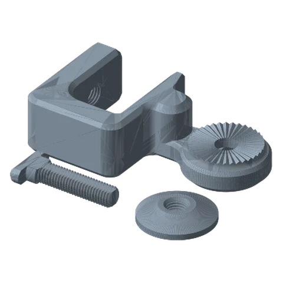
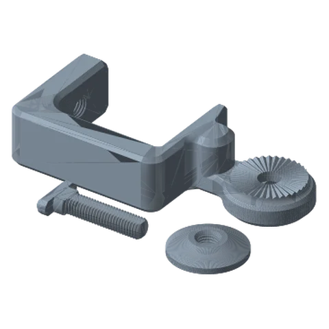
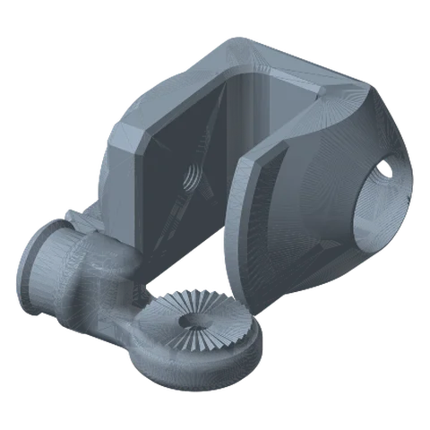
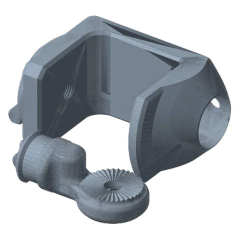

# C-Clamp Mounts Standard

*Clamp an arm to a desk, shelf or workbench edge without drilling. Two styles, five opening sizes each.*

!!! abstract "Where it lives"
    `1. Base Mounts/Clamp Mounts/Fixed C-Clamp Mount/`  
    `1. Base Mounts/Clamp Mounts/Rotating C-Clamp Mount/`  
    **3MF:** `Desk Fixed C-Clamp Collection (40-80mm).3mf`, `Rotating C-Clamp Collection (40-80mm).3mf`  
    **Buy:** Nothing.

<figure><figcaption>Fixed C-Clamp: 40 mm opening<small>Base + 60 mm screw + round pad</small></figcaption></figure>
<figure><figcaption>Fixed C-Clamp: 80 mm opening<small>one plate per size (5)</small></figcaption></figure>
<figure><figcaption>Rotating C-Clamp: 40 mm<small>Base + screw + link joint + set screw</small></figcaption></figure>
<figure><figcaption>Rotating C-Clamp: 80 mm<small>one plate per size (5)</small></figcaption></figure>

## Fixed vs Rotating

| | **Fixed C-Clamp** | **Rotating C-Clamp** |
|---|---|---|
| Arm rotation at the base | None (the first joint's rosette is part of the clamp) | Base Link Joint spins in the clamp body; a printed **Set Screw** locks it |
| Parts per build | Base, 60 mm Screw, Round Pad | Base, 60 mm Screw, Base Link Joint, Set Screw |
| Best for | Arms that stay put: webcam, starter arm | Arms you swing away: mic boom, laptop, overhead rig |
| Footprint | 151–191 × 82.5 mm, 38 mm tall | 102–142 × 95 mm, 76 mm tall |

## Pick the opening size

The number in the filename is the **clamp opening**, i.e. the maximum thickness of the surface it grips.

| Your desk / shelf thickness | Print |
|---|---|
| up to ~40 mm | `Base 40mm` |
| 40–50 mm | `Base 50mm` |
| 50–60 mm | `Base 60mm` |
| 60–70 mm | `Base 70mm` |
| 70–80 mm | `Base 80mm` |

!!! tip "Pick the smallest opening that fits"
    The 60 mm clamp screw has a limited throw. The smallest opening that fits leaves the most thread for clamping and keeps the lever arm short.

!!! warning "Filename quirk"
    Inside the Fixed C-Clamp 3MF the objects are labelled `Base 40cm … 80cm`. They are the same **mm** parts as the STLs.

## Assembly

1. Thread the **Screw 60mm** up through the bottom jaw. On the Fixed clamp, press the **Round Pad** onto its tip so it doesn't mark the desk.
2. Slide the clamp onto the desk edge and tighten by hand.
3. *Rotating clamp only:* drop the **Base Link Joint** into the top of the clamp body, turn it to the direction you want, then tighten the **Set Screw** to lock it (or leave it loose for a free-swinging base).
4. Attach your first link to the clamp's rosette with one link hardware set.

!!! tip "Round Pad on the Rotating clamp"
    The Round Pad is only packaged with the Fixed clamp, but both clamps use an identical 60 mm screw, so print a pad for the Rotating clamp too. And don't crank it: a backer's PETG clamp cracked at the inner curve from over-tightening.

## Files

| File | Size as printed (X × Y × Z mm) |
|---|---|
| `Fixed C-Clamp Mount - Base 40mm.STL` | 151.5 x 82.5 x 38.1 |
| `Fixed C-Clamp Mount - Base 50mm.STL` | 161.5 x 82.5 x 38.1 |
| `Fixed C-Clamp Mount - Base 60mm.STL` | 171.5 x 82.5 x 38.1 |
| `Fixed C-Clamp Mount - Base 70mm.STL` | 181.5 x 82.5 x 38.1 |
| `Fixed C-Clamp Mount - Base 80mm.STL` | 191.5 x 82.5 x 38.1 |
| `Fixed C-Clamp Mount - Round Pad.STL` | 50.8 x 50.8 x 10.2 |
| `Fixed C-Clamp Mount - Screw 60mm.STL` | 67.6 x 33.0 x 10.2 |
| `Rotating C-Clamp Mount - Base 40mm.STL` | 102.2 x 95.2 x 76.2 |
| `Rotating C-Clamp Mount - Base 50mm.STL` | 112.2 x 95.2 x 76.2 |
| `Rotating C-Clamp Mount - Base 60mm.STL` | 122.2 x 95.2 x 76.2 |
| `Rotating C-Clamp Mount - Base 70mm.STL` | 132.2 x 95.2 x 76.2 |
| `Rotating C-Clamp Mount - Base 80mm.STL` | 142.2 x 95.2 x 76.2 |
| `Rotating C-Clamp Mount - Screw 60mm.STL` | 67.6 x 33.0 x 10.2 |
| `Rotating Mount - Base Link Joint.STL` | 106.4 x 55.9 x 40.1 |
| `Rotating Mount - Set Screw.STL` | 24.1 x 28.6 x 10.2 |

## Used in blueprints

* [1. Starter Webcam / Phone Arm](../../blueprints/starter-webcam-arm.md)
* [2. Floating Laptop Riser](../../blueprints/laptop-riser-arm.md)
* [5. Overhead Top-Down Camera Rig](../../blueprints/overhead-camera-rig.md)
