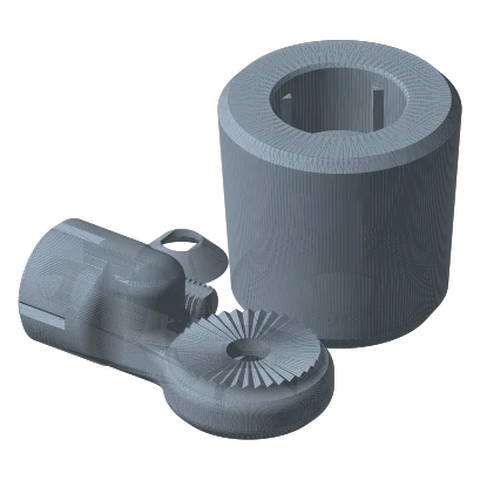
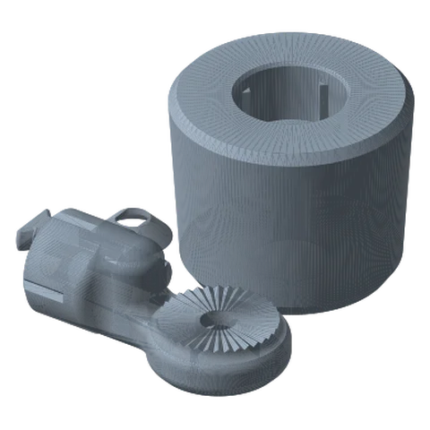

# Cup Holder Mount Ultimate

*A plug that drops into a car (or desk-organizer) cup holder and gives you a link joint on top.*

!!! abstract "Where it lives"
    `1. Base Mounts/Vehicle Mounts/Cup Holder Mount/`  
    **3MF:** `Cup Holder Mount.3mf`  
    **Buy:** Optional felt tape.

<figure><figcaption>Cup Holder: 80 mm<small>base, joint, screw, washer</small></figcaption></figure>
<figure><figcaption>Cup Holder: 95 mm</figcaption></figure>

| Print | Fits a cup holder about |
|---|---|
| `Base 80mm` | 80 mm Ø |
| `Base 85mm` | 85 mm Ø |
| `Base 90mm` | 90 mm Ø |
| `Base 95mm` | 95 mm Ø |

Each 3MF plate is a complete kit: Base, Base Link Joint, Screw, Washer.

Measure the cup holder's inside diameter **near the top** and print the size that equals it or sits just under. If it rattles, add a wrap of felt tape.
v1.1 fixed this part's STL print orientation, so print it the way it's supplied.

!!! danger "Car interiors get hot"
    A car parked in the sun can go well past 60 °C inside, and PLA+ softens around there. Print vehicle parts in **ASA/ABS** (best) or **PETG** (minimum). See [Materials](../../guide/materials.md).

## Files

| File | Size as printed (X × Y × Z mm) |
|---|---|
| `Cup Holder Mount - Base 80mm.STL` | 79.5 x 79.5 x 76.2 |
| `Cup Holder Mount - Base 85mm.STL` | 84.5 x 84.5 x 76.2 |
| `Cup Holder Mount - Base 90mm.STL` | 89.5 x 89.5 x 76.2 |
| `Cup Holder Mount - Base 95mm.STL` | 94.5 x 94.5 x 76.2 |
| `Cup Holder Mount - Base Link Joint.STL` | 106.4 x 55.9 x 40.1 |
| `Cup Holder Mount - Screw.STL` | 62.2 x 21.3 x 10.2 |
| `Cup Holder Mount - Washer.STL` | 30.5 x 30.5 x 8.4 |

## Used in blueprints

* [8. Car Cup-Holder Phone Mount](../../blueprints/car-cupholder-phone.md)
