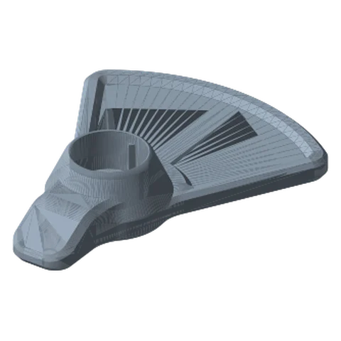
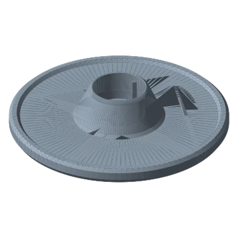
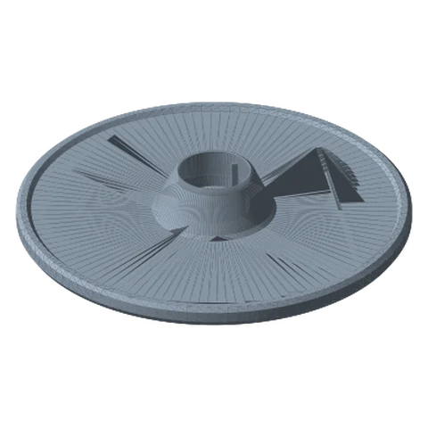
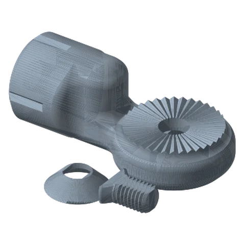

# Desk Bases (Round & Foot) Standard

*Free-standing footprints for light payloads, or screw-down bases for a permanent install. No clamp required.*

!!! abstract "Where it lives"
    `1. Base Mounts/Desk Mounts/`  
    **3MF:** `Base Mount - Desk Base Collection.3mf`  
    **Buy:** Optional: rubber feet / non-slip pad.

<figure><figcaption>Foot Base: 200 mm</figcaption></figure>
<figure><figcaption>Round Base: 180 mm</figcaption></figure>
<figure><figcaption>Round Base: 240 mm</figcaption></figure>
<figure><figcaption>Link Joint & Hardware<small>shared by all desk bases</small></figcaption></figure>

## What's in the folder

| Part | Sizes | Notes |
|---|---|---|
| **Round Base** | 180 / 200 / 220 / 240 mm Ø | Disc footprint, 37.6 mm tall |
| **Foot Base** | 200 / 220 / 240 mm | Fan/teardrop footprint. Point the long side **under the payload** |
| **Desk Mount - Base Link Joint** | 1 | The rosette joint that stands on the base |
| **Desk Mount - Screw / Washer** | 1 each | Fixes the Link Joint to the base from below |

Both footprints share the same Link Joint, screw and washer (plate 8 of the collection 3MF).

## Choosing a footprint

* **Round** when the arm will be rotated in all directions.
* **Foot** when the arm always leans one way (tablet over a desk, a light off to one side). The long lobe goes under the load.
* Bigger is more stable. These bases work by footprint alone, so for anything past a phone or webcam, look at the **Weighted Base** or a clamp.

## Assembly

1. Put the washer on the screw, pass it up through the underside of the base, and thread it into the Base Link Joint.
2. Snug it with the tool; the joint should not spin on the base.
3. Add rubber feet or a strip of non-slip mat under the base if it walks on the desk.

## Files

| File | Size as printed (X × Y × Z mm) |
|---|---|
| `Desk Mount - Base Link Joint.STL` | 106.4 x 55.9 x 40.1 |
| `Desk Mount - Screw.STL` | 22.9 x 21.3 x 10.2 |
| `Desk Mount - Washer.STL` | 30.5 x 30.5 x 8.4 |
| `Fixed Rotating Base/Fixed Rotating Base - Base Link Joint.STL` | 106.4 x 55.9 x 40.1 |
| `Fixed Rotating Base/Fixed Rotating Base - Base.STL` | 70.7 x 70.7 x 37.6 |
| `Fixed Rotating Base/Fixed Rotating Base - Set Screw.STL` | 24.1 x 28.5 x 10.2 |
| `Foot Base/Foot Base - 200mm.STL` | 157.9 x 200.2 x 37.6 |
| `Foot Base/Foot Base - 220mm.STL` | 181.3 x 220.8 x 37.6 |
| `Foot Base/Foot Base - 240mm.STL` | 203.5 x 240.3 x 37.6 |
| `Round Base/Round Base - 180mm.STL` | 180.0 x 180.0 x 37.6 |
| `Round Base/Round Base - 200mm.STL` | 200.0 x 200.0 x 37.6 |
| `Round Base/Round Base - 220mm.STL` | 220.0 x 220.0 x 37.6 |
| `Round Base/Round Base - 240mm.STL` | 240.0 x 240.0 x 37.6 |

## Used in blueprints

* [3. Podcast Mic Boom](../../blueprints/podcast-mic-boom.md)
* [7. Stacked Portable Monitors](../../blueprints/stacked-portable-monitors.md)
