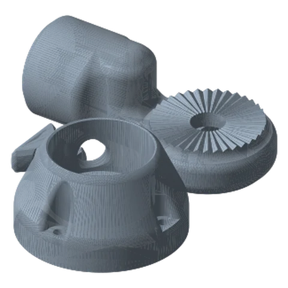
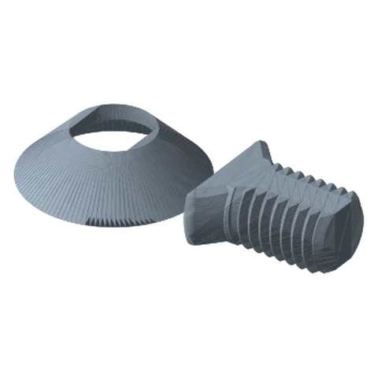

# Fixed Rotating Base Ultimate

*A compact screw-down socket. The link joint rotates in it and a set screw locks it. The strongest desk-surface mount in the library.*

!!! abstract "Where it lives"
    `1. Base Mounts/Desk Mounts/Fixed Rotating Base/`  
    **3MF:** `Fixed Rotating Base.3mf`  
    **Buy:** 3× wood screws (countersunk), length to suit your desktop.

<figure><figcaption>Fixed Rotating Desk Mount<small>Link joint, base, set screw</small></figcaption></figure>
<figure><figcaption>Hardware<small>Desk Mount screw + washer</small></figcaption></figure>

{ width="300" align=right .hero-img }

Added in **v1.3**. The base is a 70.7 mm Ø cone that you screw to the desk surface (three countersunk holes).
The **Base Link Joint** sits in the cup and rotates freely until you tighten the side **Set Screw**.

**Parts:** Base, Base Link Joint, Set Screw (plate 1) + Desk Mount Screw & Washer (plate 2: the same ones used by the Desk Bases).

## Assembly

1. Seat the **Base Link Joint** in the cup of the Base.
2. From underneath, pass the Desk Mount **Screw** through its cone **Washer** and up into the Link Joint. It holds the joint captive. Tighten until the joint turns smoothly without wobble. (Do this **before** the base goes on the desk: the screw head sits on the underside.)
3. Screw the Base to the desk with 3 wood screws.
4. Thread in the side **Set Screw** to lock rotation when needed.

!!! note "Print profile"
    The supplied 3MF for this part uses Bambu's *0.28 mm Extra Draft* profile (2 walls, 15 % infill). For a base that carries a whole arm, bump it to the general guide: **4+ walls, 20 %+ infill**.

## Files

| File | Size as printed (X × Y × Z mm) |
|---|---|
| `Fixed Rotating Base - Base Link Joint.STL` | 106.4 x 55.9 x 40.1 |
| `Fixed Rotating Base - Base.STL` | 70.7 x 70.7 x 37.6 |
| `Fixed Rotating Base - Set Screw.STL` | 24.1 x 28.5 x 10.2 |

## Used in blueprints

* [3. Podcast Mic Boom](../../blueprints/podcast-mic-boom.md)
* [7. Stacked Portable Monitors](../../blueprints/stacked-portable-monitors.md)
