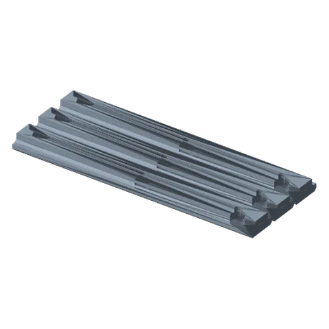
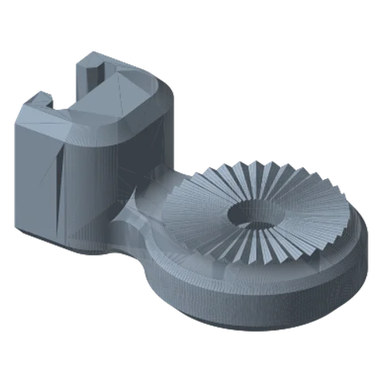
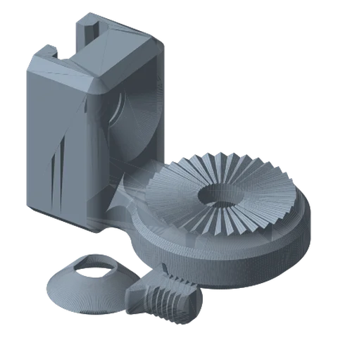

# Rail System Ultimate

*A screw-down track that one or more arms slide along. Great for workbenches and long desks.*

!!! abstract "Where it lives"
    `1. Base Mounts/Rail System Mount/`  
    **3MF:** `Rail System.3mf`  
    **Buy:** Countersunk wood screws for the rails.

<figure><figcaption>Rails 200 mm ×3</figcaption></figure>
<figure><figcaption>Rail Link Joint<small>free-sliding</small></figcaption></figure>
<figure><figcaption>Rail Locking Link Joint<small>+ screw & washer</small></figcaption></figure>

**Parts**

| Part | Qty | Role |
|---|---|---|
| Rail 200mm | as many as you need (3 per plate) | Butt them end-to-end for longer tracks |
| Base Link Joint | 1 per arm | Slides along the rail freely |
| Locking Base Link Joint | 1 per arm | Slides, then locks in place with its own Screw + Washer |

## Install

1. Print rails and screw them to the surface **flange-up** (the counterbored side faces you; the narrow stem sits on the surface), in a straight line, ends butted tight. The holes take M4 / #8 screws at 80 mm pitch.
2. Slide on the link joints from the open end, one per arm.
3. For arms that must not move, use the **Locking** joint and tighten its screw.

## Profile & aluminium options

The rail is a **1″ × 0.45″ inverted T**: a 25.4 × 5.08 mm flange on a 15.24 mm stem. It isn't an industry-standard profile, so you can't buy a drop-in aluminium rail. You can make one from a **1″ × 3/16″ flat bar on a 1/2″ × 1/4″ spacer bar**, or **bolt the printed rails onto 2020 extrusion** (the holes land on a 20 mm grid). Dimensioned drawing and details: [Engineering Notes: rail profile](../../reference/engineering.md#the-rail-profile).

## Files

| File | Size as printed (X × Y × Z mm) |
|---|---|
| `Rail System - Base Link Joint.STL` | 88.4 x 55.9 x 38.1 |
| `Rail System - Locking Base Link Joint - Screw.STL` | 19.0 x 21.3 x 10.2 |
| `Rail System - Locking Base Link Joint - Washer.STL` | 30.5 x 30.5 x 8.4 |
| `Rail System - Locking Base Link Joint.STL` | 88.4 x 55.9 x 57.2 |
| `Rail System - Rail 200mm.STL` | 200.0 x 25.4 x 11.4 |

## Used in blueprints

* [9. Workbench Helping Hands (Rail)](../../blueprints/workbench-helping-hands.md)
