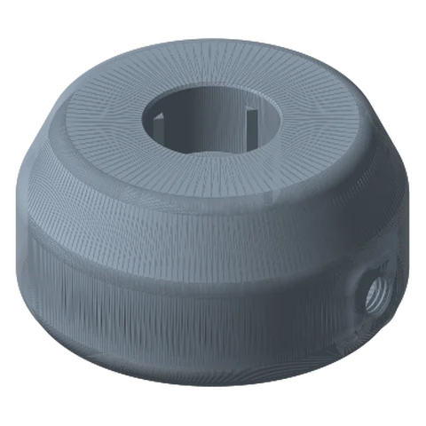
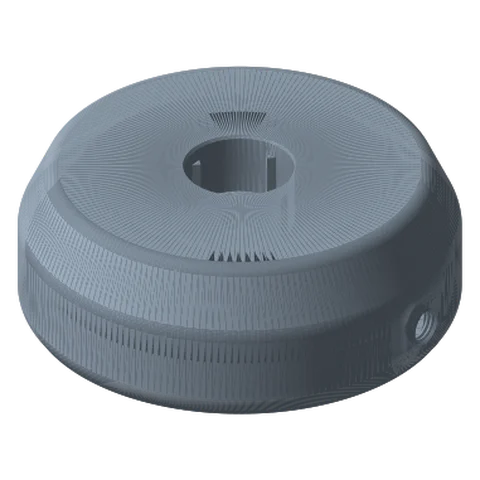
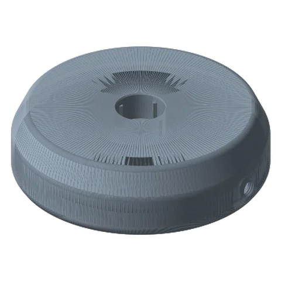
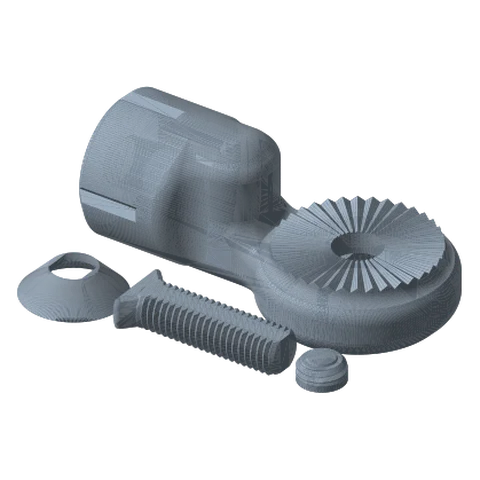

# Weighted Bases Ultimate

*Hollow bases you fill with ballast. Free-standing stability for bigger arms, with no clamp and no holes.*

!!! abstract "Where it lives"
    `1. Base Mounts/Weighted Bases/`  
    **3MF:** `Weighted Base.3mf`  
    **Buy:** Ballast: sand, steel shot or BBs.

<figure><figcaption>Weighted Base: 125 mm</figcaption></figure>
<figure><figcaption>Weighted Base: 175 mm</figcaption></figure>
<figure><figcaption>Weighted Base: 225 mm</figcaption></figure>
<figure><figcaption>Link Joint & Hardware<small>joint, screw, washer, plug</small></figcaption></figure>

| Size | Footprint | Height |
|---|---|---|
| Small | 125 mm | 63.5 mm |
| Medium | 175 mm | 63.5 mm |
| Large | 225 mm | 63.5 mm |

**Shared parts (plate 4):** Base Link Joint, Screw, Washer, **Plug**.

## Filling

1. Print the base (3 walls / 20 % is fine; the ballast does the work).
2. Fill through the plug hole with **dry sand, steel shot, BBs or lead-free fishing weights**. Tap the base to settle it and top up.
3. Close the hole with the printed **Plug** (a dab of glue makes it permanent).
4. Fix the Base Link Joint with the Screw + Washer.

## How much ballast?

Cavity volumes estimated from cross-sections of the STLs (see [Engineering Notes](../../reference/engineering.md#mass-of-printed-parts)):

| Base | Cavity ≈ | Dry sand ≈ | Steel BBs / shot ≈ |
|---|---|---|---|
| Small 125 | 0.3 L | 0.45 kg | 1.4 kg |
| Medium 175 | 0.75 L | 1.1 kg | 3.4 kg |
| Large 225 | 1.3 L | 2.0 kg | 5.9 kg |

The campaign suggests “sand, steel BBs, etc.” The fill hole is on the side wall and appears threaded for the printed Plug.

!!! tip "How big?"
    Rule of thumb: the base's radius should be at least ⅓ of the arm's horizontal reach, and heavier is always better.
    Small → phone/webcam; Medium → mic, light; Large → tablet arm, creator rig. The [Load Calculator](../../blueprints/load-calculator.md) runs a tip-over check.

## Files

| File | Size as printed (X × Y × Z mm) |
|---|---|
| `Weighted Base - Base Link Joint.STL` | 106.4 x 55.9 x 40.1 |
| `Weighted Base - Large - 225mm.STL` | 229.0 x 226.9 x 63.5 |
| `Weighted Base - Medium - 175mm.STL` | 178.2 x 176.1 x 63.5 |
| `Weighted Base - Plug.STL` | 14.0 x 14.0 x 6.9 |
| `Weighted Base - Screw.STL` | 49.5 x 21.3 x 10.2 |
| `Weighted Base - Small - 125mm.STL` | 127.4 x 125.3 x 63.5 |
| `Weighted Base - Washer.STL` | 30.5 x 30.5 x 8.4 |

## Used in blueprints

* [4. Bedside / Couch Tablet Arm](../../blueprints/bedside-tablet-arm.md)
* [6. Creator Rig: Camera + Light (+ Mic)](../../blueprints/creator-rig.md)
