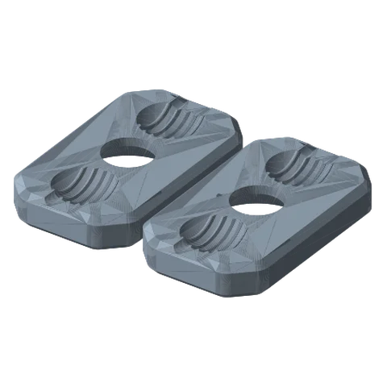
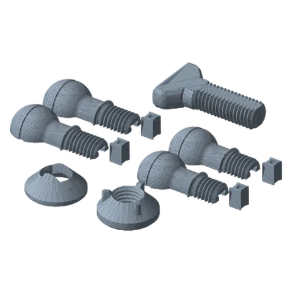

# Ball Joint Link Ultimate

*A double-ball “RAM-style” arm for fast, free positioning of the payload. One knob locks both balls.*

!!! abstract "Where it lives"
    `2. Links/1. Locking Links/3. Payload Links/Ball Joint Link/`  
    **3MF:** `Ball Joint Link.3mf`  
    **Buy:** Optional CA glue.

<figure><figcaption>Clamps<small>top + bottom</small></figcaption></figure>
<figure><figcaption>Hardware<small>ball mounts, wedges, screw, washer, nut</small></figcaption></figure>

Added in **v1.4**. Printed at **0.20 mm** in the supplied 3MF (finer layers for smooth balls).

## Parts

| Part | Qty | Role |
|---|---|---|
| Clamp Top / Clamp Bottom | 1 each | The two socket plates that squeeze the balls |
| Link Ball Mount P1 + P2 | 1 each | Ball on the **arm** side (printed in two halves) |
| Payload Ball Mount P1 + P2 | 1 each | Ball on the **payload** side (two halves) |
| Ball Mount Wedge | 4 | Key the P1/P2 halves together |
| Set Screw / Washer / Nut | 1 each | Clamps the plates together, locking both balls |
| `Payload Attachments/Ball Joint - Phone Mount - Cover` | optional | A phone-mount cover for the ball-joint payload side |

## Assembly

1. Join each ball mount's **P1 + P2** halves with two **Wedges** (a drop of CA glue makes it permanent).
2. Sandwich both balls between **Clamp Top** and **Clamp Bottom**.
3. Pass the **Set Screw** through the centre, add Washer + Nut, and tighten until both balls lock.

!!! question "Inferred"
    The library doesn't document how the Link Ball Mount attaches to the arm. By its name and folder (*Payload Links*) it takes the place of a payload link. Test-fit against your last link before printing a full set.

## Files

| File | Size as printed (X × Y × Z mm) |
|---|---|
| `Ball Joint Link - Ball Mount Wedge.STL` | 6.7 x 6.4 x 9.9 |
| `Ball Joint Link - Clamp Bottom.STL` | 38.1 x 63.5 x 10.2 |
| `Ball Joint Link - Clamp Top.STL` | 38.1 x 63.5 x 10.2 |
| `Ball Joint Link - Link Ball Mount P1.STL` | 45.2 x 23.3 x 11.6 |
| `Ball Joint Link - Link Ball Mount P2.STL` | 45.2 x 23.3 x 11.6 |
| `Ball Joint Link - Nut.STL` | 29.2 x 29.2 x 12.7 |
| `Ball Joint Link - Payload Ball Mount P1.STL` | 49.0 x 23.3 x 11.6 |
| `Ball Joint Link - Payload Ball Mount P2.STL` | 49.0 x 23.3 x 11.6 |
| `Ball Joint Link - Set Screw.STL` | 50.8 x 30.3 x 10.2 |
| `Ball Joint Link - Washer.STL` | 29.2 x 29.2 x 11.9 |
| `Payload Attachments/Ball Joint - Phone Mount - Cover.STL` | 66.0 x 10.8 x 50.8 |
