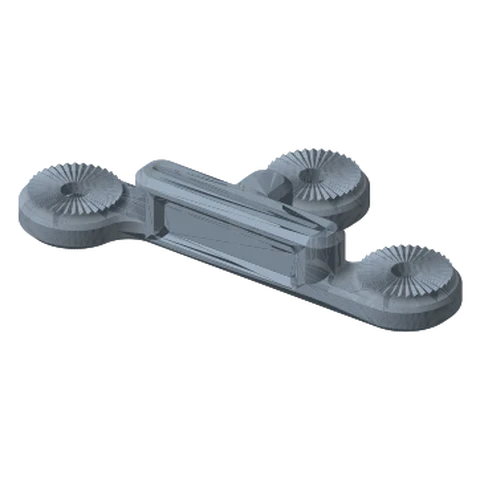
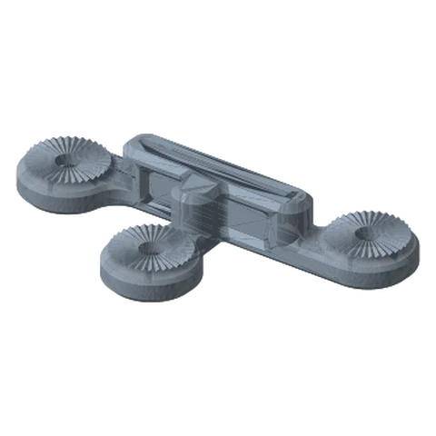
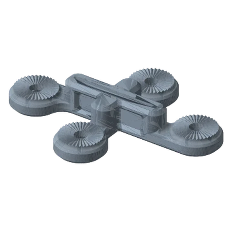

# Branch Links Standard

*Split one arm into two or three. The key to camera + light rigs and stacked monitors.*

!!! abstract "Where it lives"
    `2. Links/1. Locking Links/4. Branch Links/`  
    **3MF:** `Standard Links Collection.3mf (plates 14–16)`  
    **Buy:** Nothing.

<figure><figcaption>3-Way Branch: Top</figcaption></figure>
<figure><figcaption>3-Way Branch: Bottom</figcaption></figure>
<figure><figcaption>4-Way Branch</figcaption></figure>

| File | Outputs | Size |
|---|---|---|
| `3-Way Branch Link - Top` | 1 in → 2 out | 233.7 × 134.1 mm |
| `3-Way Branch Link - Bottom` | 1 in → 2 out (mirrored) | 233.7 × 134.1 mm |
| `4-Way Branch Link` | 1 in → 3 out | 233.7 × 181.8 mm |

The long axis carries rosettes at both ends (~178 mm apart); the side stub(s) come off the middle.
**Top** and **Bottom** are mirror variants, so choose by which side you want the side branch on.

**End markings (measured):** one end of the main axis and **every side stub** is ●. Only the far end is ●●. So whatever you attach to a side stub must present its ●● end.

Each rosette you use needs its own link hardware set: a 3-way that's fully used = 3 sets.

!!! tip "Load balance"
    Branch rigs tip over sideways, not forwards. Put the heavier branch over the base, or counter it with the other branch.

## Files

| File | Size as printed (X × Y × Z mm) |
|---|---|
| `3-Way Branch Link - Bottom.STL` | 233.7 x 134.1 x 38.1 |
| `3-Way Branch Link - Top.STL` | 233.7 x 134.1 x 38.1 |
| `4-Way Branch Link.STL` | 233.7 x 181.8 x 38.1 |

## Used in blueprints

* [6. Creator Rig: Camera + Light (+ Mic)](../../blueprints/creator-rig.md)
* [7. Stacked Portable Monitors](../../blueprints/stacked-portable-monitors.md)
