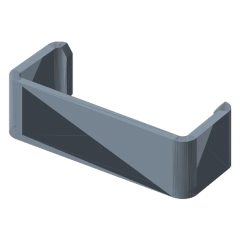
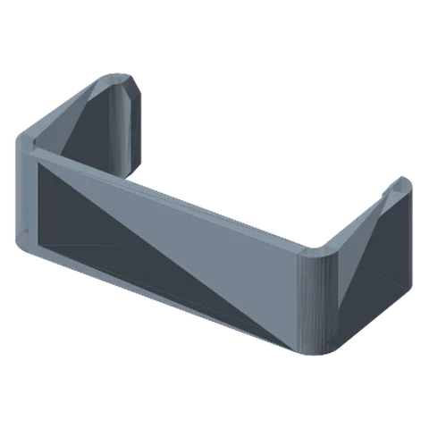

# Cable Management Clips 

*Snap-on clips that hold USB, XLR and power cables along the links.*

!!! abstract "Where it lives"
    `2. Links/1. Locking Links/5. Cable Management/`  
    **3MF:** `CABLE MANAGEMENT CLIPS.3mf`  
    **Buy:** Nothing.

<figure><figcaption>Clip: 15 mm</figcaption></figure>
<figure><figcaption>Clip: 18 mm</figcaption></figure>

Added in **v1.2**. Four sizes: **15, 16, 17, 18 mm** (the clip's inner opening). They differ only in how tightly they grip.

!!! tip "Dial in your fit"
    Print one of each size (they take minutes) and keep whichever snaps on firmly without cracking. Your flow calibration decides this more than anything else. Then print a batch of that size.

Use 1 clip every ~100–150 mm of cable run, plus one on each side of a joint so the cable has a service loop to flex.

## Files

| File | Size as printed (X × Y × Z mm) |
|---|---|
| `Cable Management Clip - 15mm.STL` | 42.5 x 16.9 x 12.7 |
| `Cable Management Clip - 16mm.STL` | 42.5 x 17.9 x 12.7 |
| `Cable Management Clip - 17mm.STL` | 42.5 x 18.9 x 12.7 |
| `Cable Management Clip - 18mm.STL` | 42.5 x 19.9 x 12.7 |

## Used in blueprints

* [3. Podcast Mic Boom](../../blueprints/podcast-mic-boom.md)
* [5. Overhead Top-Down Camera Rig](../../blueprints/overhead-camera-rig.md)
* [6. Creator Rig: Camera + Light (+ Mic)](../../blueprints/creator-rig.md)
