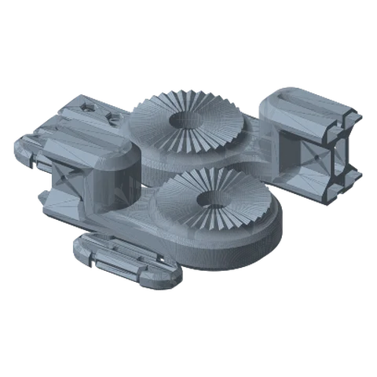
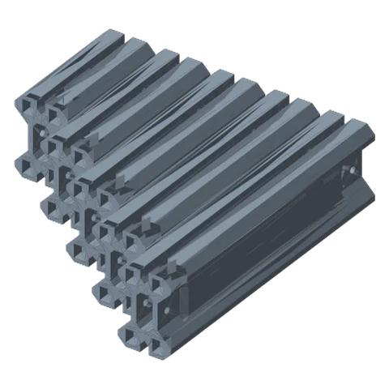
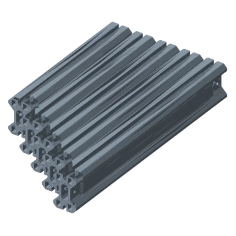
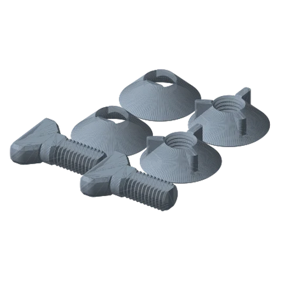

# Modular Link Ultimate

*Build a link of any length from 60 to 300 mm (in 20 mm steps): two toothed end joints plus a straight body extrusion.*

!!! abstract "Where it lives"
    `2. Links/1. Locking Links/1. Modular Link/`  
    **3MF:** `Modular Link.3mf`  
    **Buy:** Nothing (the product render shows small screws at the braces; if your braces don't hold by themselves, use short M3 screws).

<figure><figcaption>Joint Components<small>teethed joints, braces, washers</small></figcaption></figure>
<figure><figcaption>Bodies 60–140 mm</figcaption></figure>
<figure><figcaption>Bodies 160–240 mm</figcaption></figure>
<figure><figcaption>Modular Link Hardware<small>2 link hardware sets</small></figcaption></figure>

## Parts per Modular Link

| Part | Qty | Notes |
|---|---|---|
| Teethed Joint - 1 | 1 | End joint (single-dot type) |
| Teethed Joint - 2 | 1 | End joint (double-dot type) |
| Link Body - *N*mm | 1 | 60, 80, 100 … 300 mm (11 lengths) |
| Locking Brace | 2 | Lock the body into the end joints |
| Screw Washer / Nut Washer | 1 each | Oblong washers for the joint hardware |

Plus link hardware sets for the joints at each end (the folder has its own `HARDWARE/` copy, identical to the Standard Links hardware).

## Why use it

* Lengths the Standard Links don't have (e.g. 60, 80, 100 mm stubs, or 240 mm).
* Long reaches printed as short parts: the body prints standing/flat and fits small beds.
* Parts are separable: change the reach later by swapping only the body.

!!! question "Effective length (estimate)"
    The library doesn't state the pivot-to-pivot length of an assembled Modular Link. From the part geometry it's roughly **body length + ~100 mm**. Measure your first assembly and note it here.

## Assembly (from the product render)

1. Slide the body into each Teethed Joint.
2. Fit the Locking Braces to lock the body in both joints.
3. Connect the joint rosettes to neighbouring links as usual (● ↔ ●●), using the Screw Washer / Nut Washer where the render shows them.

## Files

| File | Size as printed (X × Y × Z mm) |
|---|---|
| `HARDWARE/Link Hardware - Screw.STL` | 41.9 x 30.3 x 10.2 |
| `HARDWARE/Link Hardware - Threaded Nut - No Brand.STL` | 38.1 x 38.1 x 12.7 |
| `HARDWARE/Link Hardware - Threaded Nut.STL` | 38.1 x 38.1 x 12.7 |
| `HARDWARE/Link Hardware - Washer.STL` | 38.1 x 38.1 x 12.7 |
| `Modular Link - Link Body - 100mm.STL` | 25.4 x 100.0 x 38.1 |
| `Modular Link - Link Body - 120mm.STL` | 25.4 x 120.0 x 38.1 |
| `Modular Link - Link Body - 140mm.STL` | 25.4 x 140.0 x 38.1 |
| `Modular Link - Link Body - 160mm.STL` | 25.4 x 160.0 x 38.1 |
| `Modular Link - Link Body - 180mm.STL` | 25.4 x 180.0 x 38.1 |
| `Modular Link - Link Body - 200mm.STL` | 25.4 x 200.0 x 38.1 |
| `Modular Link - Link Body - 220mm.STL` | 25.4 x 220.0 x 38.1 |
| `Modular Link - Link Body - 240mm.STL` | 25.5 x 240.0 x 38.1 |
| `Modular Link - Link Body - 260mm.STL` | 25.4 x 260.0 x 38.1 |
| `Modular Link - Link Body - 280mm.STL` | 25.5 x 280.0 x 38.1 |
| `Modular Link - Link Body - 300mm.STL` | 25.5 x 300.0 x 38.1 |
| `Modular Link - Link Body - 60mm.STL` | 25.4 x 60.0 x 38.1 |
| `Modular Link - Link Body - 80mm.STL` | 25.4 x 80.0 x 38.1 |
| `Modular Link - Locking Brace.STL` | 50.8 x 19.6 x 7.6 |
| `Modular Link - Nut Washer.STL` | 35.1 x 17.5 x 5.1 |
| `Modular Link - Screw Washer.STL` | 35.1 x 17.5 x 5.1 |
| `Modular Link - Teethed Joint - 1.STL` | 98.9 x 55.9 x 38.1 |
| `Modular Link - Teethed Joint - 2.STL` | 98.9 x 55.9 x 38.1 |

## Used in blueprints

* [4. Bedside / Couch Tablet Arm](../../blueprints/bedside-tablet-arm.md)
