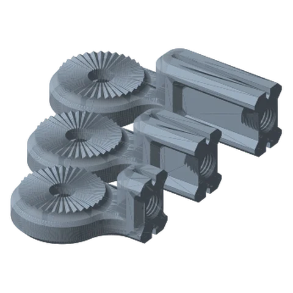
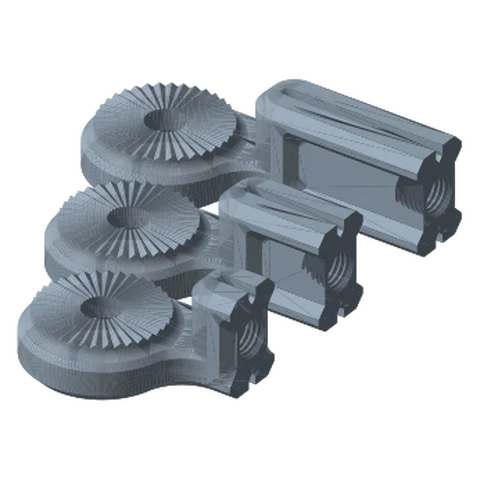
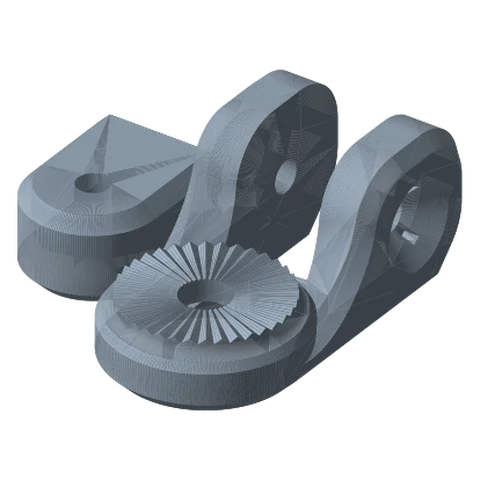
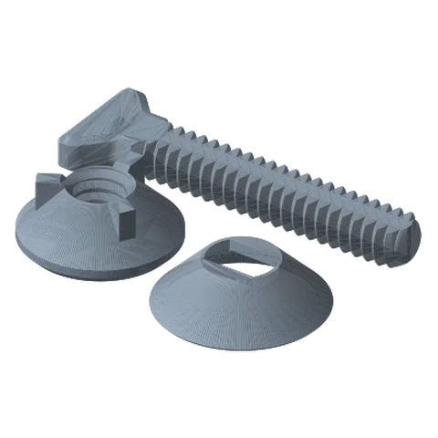

# Payload Links (Fixed & Swivel) Standard

*The last link in the chain: a rosette on one end, a payload interface on the other.*

!!! abstract "Where it lives"
    `2. Links/1. Locking Links/3. Payload Links/Payload Link - Fixed/`  
    `2. Links/1. Locking Links/3. Payload Links/Payload Link - Swivel/`  
    **3MF:** `Standard Links Collection.3mf (plates 9–13)`  
    **Buy:** Nothing.

<figure><figcaption>Fixed Payload Links: 1 Circle<small>50 / 75 / 100 mm</small></figcaption></figure>
<figure><figcaption>Fixed Payload Links: 2 Circles<small>50 / 75 / 100 mm</small></figcaption></figure>
<figure><figcaption>Swivel: 1 Circle<small>body + insert</small></figcaption></figure>
<figure><figcaption>Swivel Hardware<small>screw, washer, nut</small></figcaption></figure>

Every payload mount (VESA, 1/4-20, MagSafe, clamps…) fixes to a **Payload Link** with its own small Screw + Washer.

## Fixed Payload Links

| File | Reach | Variant |
|---|---|---|
| `PAYLOAD LINK - 50mm - 1` / `- 2` | 50 mm | 1 = “1 Circle”, 2 = “2 Circles” |
| `PAYLOAD LINK - 75mm - 1` / `- 2` | 75 mm | |
| `PAYLOAD LINK - 100mm - 1` / `- 2` | 100 mm | |

**Which variant?** The 3MF names them *1 Circle* and *2 Circles*: the end marking on the rosette. Pick the one that follows the ● / ●● rule with the link end you're attaching to (if the last link's free end is ●, use the 2-circle version, and vice versa).

## Swivel Payload Link

Adds a rotation axis just behind the payload, so you can turn portrait ↔ landscape or pan a camera **without loosening an arm joint**.

| Part | Qty |
|---|---|
| Swivel Body - 1 **or** - 2 (circles, as above) | 1 |
| Swivel Insert | 1 |
| Swivel - Screw / Washer / Nut | 1 each |

The swivel's own screw, washer and nut are smaller than the link hardware and are **not** interchangeable with it.

## Files

| File | Size as printed (X × Y × Z mm) |
|---|---|
| `PAYLOAD LINK - 100mm - 1.STL` | 127.9 x 55.9 x 38.1 |
| `PAYLOAD LINK - 100mm - 2.STL` | 127.9 x 55.9 x 38.1 |
| `PAYLOAD LINK - 50mm - 1.STL` | 77.9 x 55.9 x 38.1 |
| `PAYLOAD LINK - 50mm - 2.STL` | 77.9 x 55.9 x 38.1 |
| `PAYLOAD LINK - 75mm - 1.STL` | 102.9 x 55.9 x 38.1 |
| `PAYLOAD LINK - 75mm - 2.STL` | 102.9 x 55.9 x 38.1 |
| `Payload Link - Swivel - Nut.STL` | 24.1 x 24.1 x 10.2 |
| `Payload Link - Swivel - Screw.STL` | 55.4 x 17.8 x 5.8 |
| `Payload Link - Swivel - Washer.STL` | 26.2 x 26.2 x 7.6 |
| `Payload Link - Swivel Body - 1.STL` | 55.9 x 104.1 x 44.7 |
| `Payload Link - Swivel Body - 2.STL` | 55.9 x 104.1 x 44.7 |
| `Payload Link - Swivel Insert.STL` | 38.1 x 48.3 x 25.4 |

## Used in blueprints

* [1. Starter Webcam / Phone Arm](../../blueprints/starter-webcam-arm.md)
* [2. Floating Laptop Riser](../../blueprints/laptop-riser-arm.md)
* [4. Bedside / Couch Tablet Arm](../../blueprints/bedside-tablet-arm.md)
* [5. Overhead Top-Down Camera Rig](../../blueprints/overhead-camera-rig.md)
* [6. Creator Rig: Camera + Light (+ Mic)](../../blueprints/creator-rig.md)
* [7. Stacked Portable Monitors](../../blueprints/stacked-portable-monitors.md)
* [8. Car Cup-Holder Phone Mount](../../blueprints/car-cupholder-phone.md)
* [9. Workbench Helping Hands (Rail)](../../blueprints/workbench-helping-hands.md)
* [10. Kitchen Wall Tablet](../../blueprints/kitchen-wall-tablet.md)
