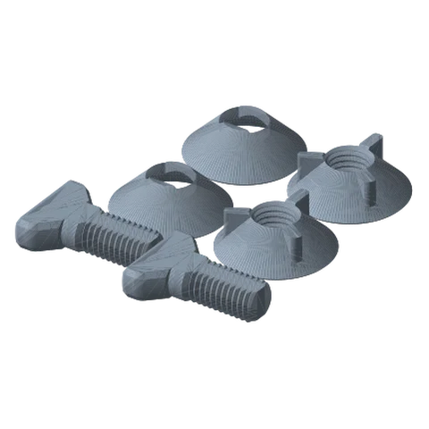
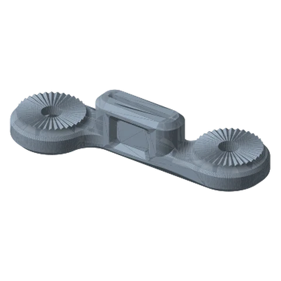
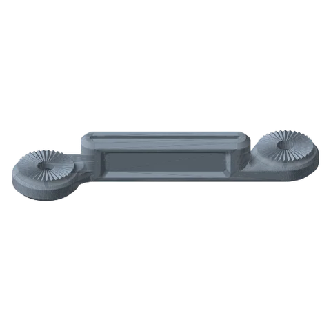
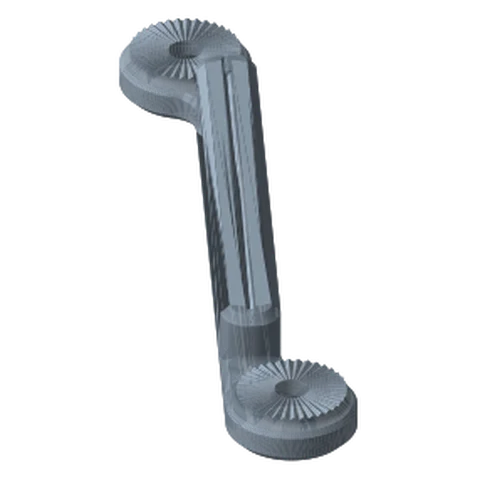

# Standard Links Standard

*The backbone of every build: one-piece links with a toothed rosette at each end, in eight lengths.*

!!! abstract "Where it lives"
    `2. Links/1. Locking Links/2. Standard Links/`  
    **3MF:** `Standard Links Collection.3mf`  
    **Buy:** Nothing. All joint hardware is printed.

<figure><figcaption>Link Hardware ×2 sets<small>screw, cone washer, threaded nut</small></figcaption></figure>
<figure><figcaption>LINK: 125 mm</figcaption></figure>
<figure><figcaption>LINK: 200 mm</figcaption></figure>
<figure><figcaption>LINK: 275 mm</figcaption></figure>

## Lengths

The number in the filename is the **pitch along the link**. The rosettes also sit 30.5 mm apart sideways, so the true pivot-to-pivot is a little longer (e.g. 202.3 mm for the 200; see [Engineering Notes](../../reference/engineering.md#links-are-cranked)). The printed part is 55.9 mm longer overall than the pitch (one rosette diameter).

| File | Pivot-to-pivot | Overall length | On a 256 × 256 mm bed |
|---|---|---|---|
| `LINK - 125mm` | 125 mm | 180.9 mm | ✔ |
| `LINK - 150mm` | 150 mm | 205.9 mm | ✔ |
| `LINK - 175mm` | 175 mm | 230.9 mm | ✔ |
| `LINK - 200mm` | 200 mm | 255.9 mm | ✔ diagonal (as placed in the 3MF) |
| `LINK - 225mm` | 225 mm | 280.9 mm | ✔ diagonal (as placed in the 3MF) |
| `LINK - 250mm` | 250 mm | 305.9 mm | ✔ diagonal (as placed in the 3MF) |
| `LINK - 275mm` | 275 mm | 330.9 mm | ✔ diagonal, just (as placed in the 3MF) |
| `LINK - 300mm` | 300 mm | 355.9 mm | ✘ needs a larger bed; not in the 3MF |

All links are 86.4 mm wide (the crank) and 38.1 mm tall as printed.

!!! note "300 mm link"
    `LINK - 300mm.STL` is in the folder but has no plate in *Standard Links Collection.3mf* (plates stop at 275 mm, the longest that fits a 256 mm bed diagonally). On a larger printer, import the STL on its own; otherwise use a 275 mm link or a [Modular Link](modular-link.md).

## Ends: ● and ●●

Each link has a **single-dot** end and a **double-dot** end (the dots are small holes inside the underside pocket). Always join **● to ●●**. The two ends' 36-tooth rings are clocked half a tooth apart, which is why the rule matters. See [How joints work](../../guide/how-it-works.md#the-one-rule-1-meets-2).

## Hardware

Every joint between two rosettes takes **one link hardware set**: `Link Hardware - Screw`, `- Washer`, `- Threaded Nut` (or `Threaded Nut - No Brand` if you prefer it without the logo). The collection's plate 1 prints two sets.

## Files

| File | Size as printed (X × Y × Z mm) |
|---|---|
| `HARDWARE/Link Hardware - Screw.STL` | 41.9 x 30.3 x 10.2 |
| `HARDWARE/Link Hardware - Threaded Nut - No Brand.STL` | 38.1 x 38.1 x 12.7 |
| `HARDWARE/Link Hardware - Threaded Nut.STL` | 38.1 x 38.1 x 12.7 |
| `HARDWARE/Link Hardware - Washer.STL` | 38.1 x 38.1 x 12.7 |
| `LINK - 125mm.STL` | 180.9 x 86.4 x 38.1 |
| `LINK - 150mm.STL` | 205.9 x 86.4 x 38.1 |
| `LINK - 175mm.STL` | 230.9 x 86.4 x 38.1 |
| `LINK - 200mm.STL` | 255.9 x 86.4 x 38.1 |
| `LINK - 225mm.STL` | 280.9 x 86.4 x 38.1 |
| `LINK - 250mm.STL` | 305.9 x 86.4 x 38.1 |
| `LINK - 275mm.STL` | 330.9 x 86.4 x 38.1 |
| `LINK - 300mm.STL` | 355.9 x 86.4 x 38.1 |

## Used in blueprints

* [1. Starter Webcam / Phone Arm](../../blueprints/starter-webcam-arm.md)
* [2. Floating Laptop Riser](../../blueprints/laptop-riser-arm.md)
* [3. Podcast Mic Boom](../../blueprints/podcast-mic-boom.md)
* [4. Bedside / Couch Tablet Arm](../../blueprints/bedside-tablet-arm.md)
* [5. Overhead Top-Down Camera Rig](../../blueprints/overhead-camera-rig.md)
* [6. Creator Rig: Camera + Light (+ Mic)](../../blueprints/creator-rig.md)
* [7. Stacked Portable Monitors](../../blueprints/stacked-portable-monitors.md)
* [8. Car Cup-Holder Phone Mount](../../blueprints/car-cupholder-phone.md)
* [9. Workbench Helping Hands (Rail)](../../blueprints/workbench-helping-hands.md)
* [10. Kitchen Wall Tablet](../../blueprints/kitchen-wall-tablet.md)
