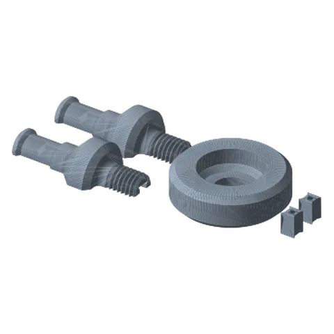
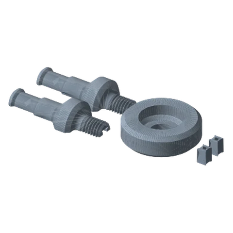
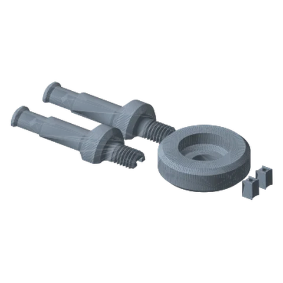

# Baby Pin Mount Ultimate

*A printed 5/8″ baby pin (stud) for lighting gear, clamps and grip accessories.*

!!! abstract "Where it lives"
    `3. Payload Mounts/Baby Pin Mount/`  
    **3MF:** `Baby Pin Mount.3mf`  
    **Buy:** Optional CA glue for the pin halves.

<figure><figcaption>Baby Pin: Short</figcaption></figure>
<figure><figcaption>Baby Pin: Standard</figcaption></figure>
<figure><figcaption>Baby Pin: Long</figcaption></figure>

Added in **v1.4**, printed at 0.20 mm in the supplied 3MF.

| Plate | Pin length |
|---|---|
| Baby Pin Mount - Small | Short (61 mm part) |
| Baby Pin Mount - Medium | Standard (69 mm) |
| Baby Pin Mount - Large | Long (81.5 mm) |

Each pin prints as **two halves (P1 + P2)** joined with **two Screw Wedges**, then threads into the shared **Base**.

Use it for LED panels, fresnels and grip heads that take a 5/8″ baby pin. Treat printed pins as light-duty: ≤ ~1 kg, short reach.

## Files

| File | Size as printed (X × Y × Z mm) |
|---|---|
| `Baby Pin Mount - Base.STL` | 50.8 x 50.8 x 15.0 |
| `Baby Pin Mount - Screw P1 - Long.STL` | 81.5 x 28.4 x 14.2 |
| `Baby Pin Mount - Screw P1 - Short.STL` | 61.2 x 28.4 x 14.2 |
| `Baby Pin Mount - Screw P1 - Standard.STL` | 68.8 x 28.4 x 14.2 |
| `Baby Pin Mount - Screw P2 - Long.STL` | 81.5 x 28.4 x 14.2 |
| `Baby Pin Mount - Screw P2 - Short.STL` | 61.2 x 28.4 x 14.2 |
| `Baby Pin Mount - Screw P2 - Standard.STL` | 68.8 x 28.4 x 14.2 |
| `Baby Pin Mount - Screw Wedge.STL` | 6.7 x 6.4 x 9.9 |

## Used in blueprints

* [6. Creator Rig: Camera + Light (+ Mic)](../../blueprints/creator-rig.md)
