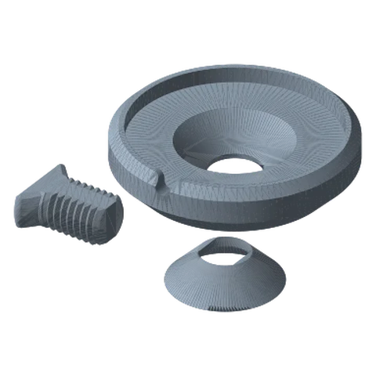
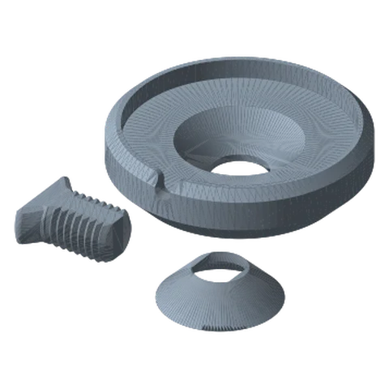

# MagSafe Mounts Standard

*A cup that holds a MagSafe puck/magnet ring so a MagSafe phone snaps on.*

!!! abstract "Where it lives"
    `3. Payload Mounts/Magsafe Mounts/`  
    **3MF:** `magSafe Mounts.3mf`  
    **Buy:** MagSafe charger puck or MagSafe-compatible magnet ring.

<figure><figcaption>MagSafe: New<small>+ screw & washer</small></figcaption></figure>
<figure><figcaption>MagSafe: Old</figcaption></figure>

Two revisions: `magSafe Mount - New` (15.2 mm tall) and `- Old` (16.5 mm). Both are 63.5 mm Ø and use the same Screw + Washer.
Test-fit your puck or ring against **New** first.

Supports are **on** (normal/auto) for both in the supplied 3MF.

!!! note
    The mount holds a MagSafe charger or magnet ring. It is not magnetic on its own.

## Files

| File | Size as printed (X × Y × Z mm) |
|---|---|
| `Magsafe Mount - Screw.STL` | 22.9 x 21.3 x 10.2 |
| `Magsafe Mount - Washer.STL` | 30.5 x 30.5 x 8.4 |
| `magSafe Mount - New.STL` | 63.5 x 63.5 x 15.2 |
| `magSafe Mount - Old.STL` | 63.5 x 63.5 x 16.5 |

## Used in blueprints

* [8. Car Cup-Holder Phone Mount](../../blueprints/car-cupholder-phone.md)
