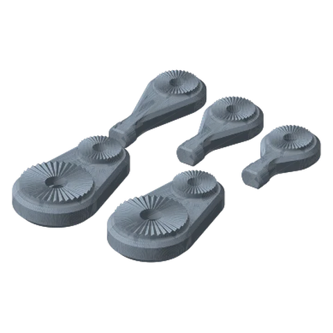
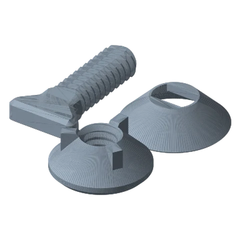

# Microphone Mount Standard

*A dedicated two-pivot mic adapter that bolts straight onto a link end.*

!!! abstract "Where it lives"
    `3. Payload Mounts/Microphone Mount/`  
    **3MF:** `Microphone Mount.3mf`  
    **Buy:** Nothing.

<figure><figcaption>Microphone Mount<small>bases (1 & 2 dots), 3 arm lengths</small></figcaption></figure>
<figure><figcaption>Microphone Mount Hardware</figcaption></figure>

Added in **v1.3**, printed at 0.20 mm in the supplied 3MF.

| Part | Qty | Notes |
|---|---|---|
| Microphone Mount Base - **1 Dots** *or* **2 Dots** | 1 | Pick the one that mates with your last link end (● ↔ ●●) |
| Microphone Mount Screw - **Short / Standard / Long** | 1 | The mic-side arm; pick the length that clears your mic body |
| Microphone Mount - Link Screw / Washer / Nut | 1 each | Small hardware for the second pivot |

The Base's large rosette joins the link with a normal link hardware set; its small rosette joins the mic-side arm with the small Link Screw/Washer/Nut, which gives the mic its own tilt axis.

!!! question "Inferred"
    The library doesn't describe the mic interface. Check how the mic-side “Screw” part meets your mic's clip or shock-mount thread before committing.

## Files

| File | Size as printed (X × Y × Z mm) |
|---|---|
| `Microphone Mount - Link Nut.STL` | 24.1 x 24.1 x 10.2 |
| `Microphone Mount - Link Screw.STL` | 34.4 x 17.8 x 5.8 |
| `Microphone Mount - Link Washer.STL` | 26.2 x 26.2 x 7.6 |
| `Microphone Mount Base - 1 Dots.STL` | 55.9 x 95.2 x 20.6 |
| `Microphone Mount Base - 2 Dots.STL` | 55.9 x 95.2 x 20.6 |
| `Microphone Mount Screw - Long.STL` | 38.1 x 84.2 x 15.6 |
| `Microphone Mount Screw - Short.STL` | 38.1 x 63.1 x 15.6 |
| `Microphone Mount Screw - Standard.STL` | 38.1 x 71.9 x 15.6 |

## Used in blueprints

* [3. Podcast Mic Boom](../../blueprints/podcast-mic-boom.md)
