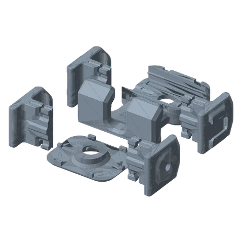
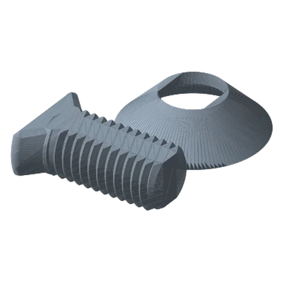

# Phone Mount Standard

*A spring-arm phone holder with two arm styles: accessory shoe or heat-set insert.*

!!! abstract "Where it lives"
    `3. Payload Mounts/Phone Mount/`  
    **3MF:** `Phone Mount.3mf`  
    **Buy:** Rubber bands; heat-set inserts if using the Heat-Insert arms.

<figure><figcaption>Phone Holder: Small<small>base, cover, both arm styles</small></figcaption></figure>
<figure><figcaption>Payload Connecting Hardware</figcaption></figure>

**Parts (plate 1):** Base - Small, Cover, 2× **Arm - Small - Hotshoe**, 2× **Arm - Small - Heat Insert**.
**Plate 2:** Payload Mount Screw + Washer.

The plate prints both arm styles. Use **one pair**:

* **Hotshoe arms:** a cold-shoe on the arm for a small light or mic next to the phone.
* **Heat-Insert arms:** take a threaded heat-set insert (size not specified; measure the bore) for a screw-on accessory.

Fix the Base to a Payload Link with the Screw + Washer.

## Files

| File | Size as printed (X × Y × Z mm) |
|---|---|
| `Phone Mount - Arm -Small - Heat Insert.STL` | 34.3 x 47.0 x 38.1 |
| `Phone Mount - Arm -Small - Hotshoe.STL` | 36.1 x 47.0 x 38.1 |
| `Phone Mount - Base - Small.STL` | 99.1 x 78.7 x 43.2 |
| `Phone Mount - Cover.STL` | 66.0 x 50.8 x 10.8 |
| `Phone Mount - Payload Mount - Screw.STL` | 30.5 x 21.3 x 10.2 |
| `Phone Mount - Payload Mount - Washer.STL` | 30.5 x 30.5 x 8.4 |

## Used in blueprints

* [9. Workbench Helping Hands (Rail)](../../blueprints/workbench-helping-hands.md)
