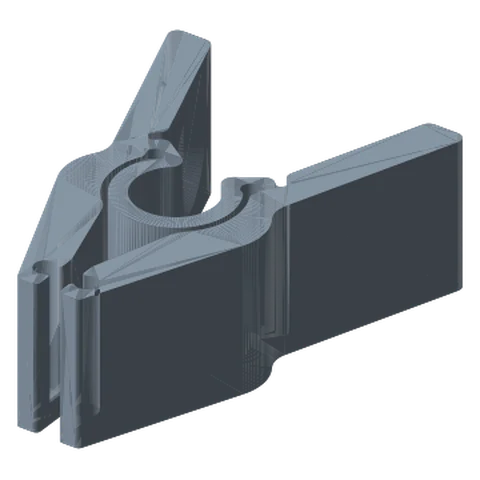
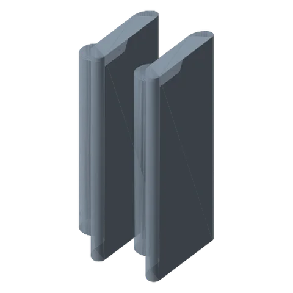

# Spring Clamp 

*A clothes-peg style clamp with soft TPU jaws for PCBs, cables, fabric, reflectors and clip-on lights.*

!!! abstract "Where it lives"
    `3. Payload Mounts/Spring Clamp/`  
    **3MF:** `Spring Clamp.3mf`  
    **Buy:** TPU filament (small amount).

<figure><figcaption>Spring Clamp Body</figcaption></figure>
<figure><figcaption>TPU Inserts</figcaption></figure>

Added in **v1.2**.

| Plate | Contents | Material |
|---|---|---|
| Spring Clamp | Body | PLA+/PETG (**supports on** as supplied) |
| Hardware | Screw + Washer | PLA+/PETG |
| Spring Clamp Inserts - TPU | 2× Insert | **TPU** |

Press the TPU inserts into the jaws, then fix the body to a Payload Link.

## Files

| File | Size as printed (X × Y × Z mm) |
|---|---|
| `Spring Clamp - Body.STL` | 90.2 x 120.6 x 44.5 |
| `Spring Clamp - Insert.STL` | 11.4 x 19.6 x 44.5 |
| `Spring Clamp - Screw.STL` | 22.9 x 21.3 x 10.2 |
| `Spring Clamp - Washer.STL` | 30.5 x 30.5 x 8.4 |

## Used in blueprints

* [9. Workbench Helping Hands (Rail)](../../blueprints/workbench-helping-hands.md)
