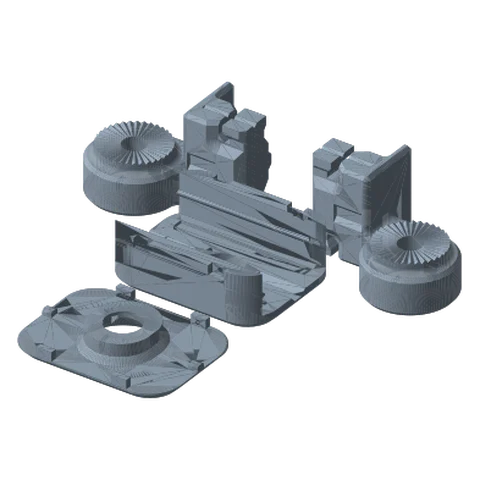
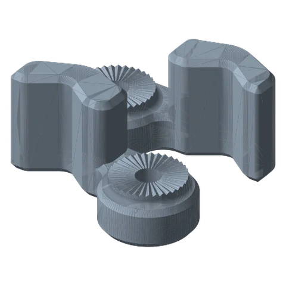
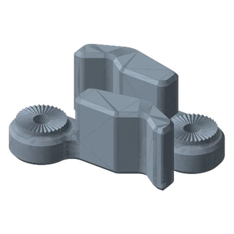
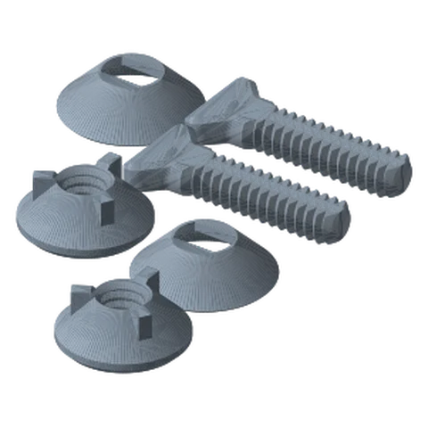

# Modular Tensioned Claw Standard

*A claw with swappable 60 / 70 / 80 mm jaws on hinged joins. Grips irregular shapes that a flat clamp can't.*

!!! abstract "Where it lives"
    `3. Payload Mounts/Modular Tensioned Claw/`  
    **3MF:** `Modular T-Claw.3mf`  
    **Buy:** Rubber bands.

<figure><figcaption>T-Claw Core<small>base, cover, arm joins</small></figcaption></figure>
<figure><figcaption>60 mm Claws</figcaption></figure>
<figure><figcaption>80 mm Claws</figcaption></figure>
<figure><figcaption>T-Claw Hardware</figcaption></figure>

| Plate | Contents |
|---|---|
| Modular T-Claw | Base, Cover, Arm Join Left + Right (supports on for the Base) |
| 60 / 70 / 80 mm Claws | One Left + Right arm pair per plate. Print the size you need |
| T-Claw Hardware | 2× Arm Joint Screw / Washer / Nut |
| Payload Connecting Hardware | Payload Mount Screw + Washer |

The Arm Joins have toothed rosettes, so each claw arm can be locked at an angle with the Arm Joint hardware. Tension comes from rubber bands.

## Files

| File | Size as printed (X × Y × Z mm) |
|---|---|
| `Hardware/Modular T-Claw - Arm Joint - Nut.STL` | 24.1 x 24.1 x 10.2 |
| `Hardware/Modular T-Claw - Arm Joint - Screw.STL` | 40.9 x 17.8 x 5.8 |
| `Hardware/Modular T-Claw - Arm Joint - Washer.STL` | 26.2 x 26.2 x 7.6 |
| `Hardware/Modular T-Claw - Payload Mount - Screw.STL` | 34.3 x 21.3 x 10.2 |
| `Hardware/Modular T-Claw - Payload Mount - Washer.STL` | 30.5 x 30.5 x 8.4 |
| `Modular T-Claw - Arm 60mm - Left.STL` | 77.8 x 39.7 x 39.4 |
| `Modular T-Claw - Arm 60mm - Right.STL` | 77.8 x 39.7 x 39.4 |
| `Modular T-Claw - Arm 70mm - Left.STL` | 87.8 x 40.9 x 39.4 |
| `Modular T-Claw - Arm 70mm - Right.STL` | 87.8 x 40.9 x 39.4 |
| `Modular T-Claw - Arm 80mm - Left.STL` | 97.8 x 41.9 x 39.4 |
| `Modular T-Claw - Arm 80mm - Right.STL` | 97.8 x 41.9 x 39.4 |
| `Modular T-Claw - Arm Join - Left.STL` | 62.2 x 46.4 x 38.1 |
| `Modular T-Claw - Arm Join - Right.STL` | 62.2 x 46.4 x 38.1 |
| `Modular T-Claw - Base.STL` | 50.8 x 66.0 x 22.5 |
| `Modular T-Claw - Cover.STL` | 66.0 x 50.8 x 10.8 |
