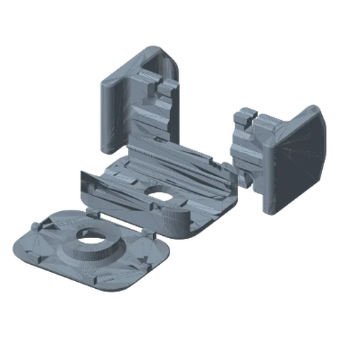
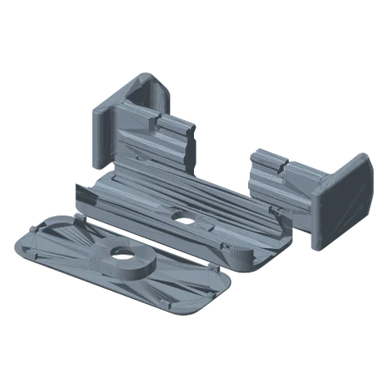
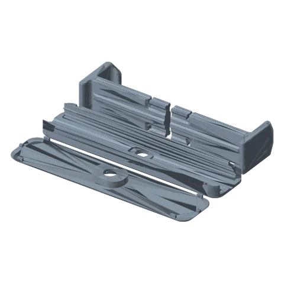

# Tensioned Clamps (S / M / L) 

*Rubber-band sprung grippers in three widths: phones, phablets/small tablets, and tablets.*

!!! abstract "Where it lives"
    `3. Payload Mounts/Tensioned Clamps/`  
    **3MF:** `S Tensioned Clamp.3mf`, `M Tensioned Clamp.3mf`, `L Tensioned Clamp.3mf`  
    **Buy:** Rubber bands.

<figure><figcaption>Small Tensioned Clamp</figcaption></figure>
<figure><figcaption>Medium Tensioned Clamp</figcaption></figure>
<figure><figcaption>Large Tensioned Clamp</figcaption></figure>
<figure><figcaption>Hardware<small>screw + washer</small></figcaption></figure>

Added in **v1.2**.

| Size | Base length | Typical device |
|---|---|---|
| Small | 66 mm | Phone, remote, small camera |
| Medium | 127 mm | Large phone / mini tablet |
| Large | 228.6 mm | Tablet |

Each is Base + Cover + **2 Arms** + Screw + Washer. Supports are on for the **S** and **M** bases in the supplied 3MFs.
Rubber bands provide the clamping force, so add bands for a firmer grip.

## Files

| File | Size as printed (X × Y × Z mm) |
|---|---|
| `Large Tensioned Clamp/L Tensioned Clamp - Arm.STL` | 101.6 x 57.1 x 38.1 |
| `Large Tensioned Clamp/L Tensioned Clamp - Base.STL` | 50.8 x 228.6 x 16.5 |
| `Large Tensioned Clamp/L Tensioned Clamp - Cover.STL` | 228.6 x 50.8 x 10.8 |
| `Large Tensioned Clamp/L Tensioned Clamp - Screw.STL` | 30.5 x 21.3 x 10.2 |
| `Large Tensioned Clamp/L Tensioned Clamp - Washer.STL` | 30.5 x 30.5 x 8.4 |
| `Medium Tensioned Clamp/M Tensioned Clamp - Arm.STL` | 57.1 x 57.1 x 38.1 |
| `Medium Tensioned Clamp/M Tensioned Clamp - Base.STL` | 50.8 x 127.0 x 16.5 |
| `Medium Tensioned Clamp/M Tensioned Clamp - Cover.STL` | 127.0 x 50.8 x 10.8 |
| `Medium Tensioned Clamp/M Tensioned Clamp - Screw.STL` | 30.5 x 21.3 x 10.2 |
| `Medium Tensioned Clamp/M Tensioned Clamp - Washer.STL` | 30.5 x 30.5 x 8.4 |
| `Small Tensioned Clamp/S Tensioned Clamp - Arm.STL` | 31.8 x 47.0 x 38.1 |
| `Small Tensioned Clamp/S Tensioned Clamp - Base.STL` | 50.8 x 66.0 x 16.5 |
| `Small Tensioned Clamp/S Tensioned Clamp - Cover.STL` | 66.0 x 50.8 x 10.8 |
| `Small Tensioned Clamp/S Tensioned Clamp - Screw.STL` | 30.5 x 21.3 x 10.2 |
| `Small Tensioned Clamp/S Tensioned Clamp - Washer.STL` | 30.5 x 30.5 x 8.4 |

## Used in blueprints

* [4. Bedside / Couch Tablet Arm](../../blueprints/bedside-tablet-arm.md)
* [10. Kitchen Wall Tablet](../../blueprints/kitchen-wall-tablet.md)
