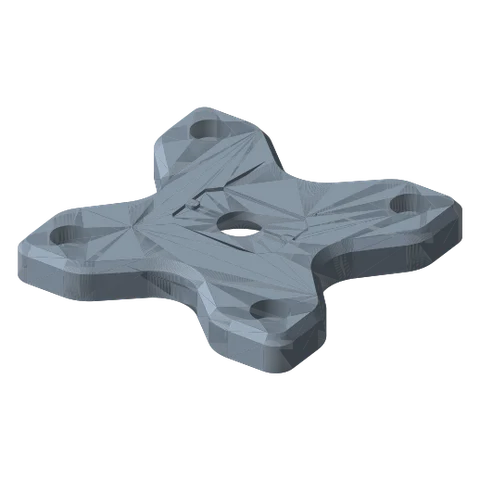
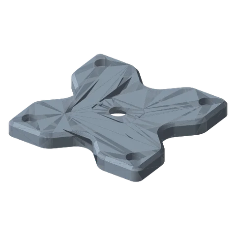

# VESA Mounts Standard

*75 × 75 and 100 × 100 VESA plates for monitors, portable displays and anything with a VESA pattern.*

!!! abstract "Where it lives"
    `3. Payload Mounts/VESA Mounts/`  
    **3MF:** `Vesa Mounts.3mf`  
    **Buy:** M4 screws + washers (length per monitor).

<figure><figcaption>VESA 75</figcaption></figure>
<figure><figcaption>VESA 100</figcaption></figure>
<figure><figcaption>Payload Connecting Hardware<small>screw + washer</small></figcaption></figure>

| File | Pattern | Plate |
|---|---|---|
| `Vesa Mount - 75mm` | 75 × 75 mm | 101.6 mm square |
| `Vesa Mount - 100mm` | 100 × 100 mm | 127 mm square |
| `Vesa Mount - Screw` + `- Washer` | | Fix the plate to a Payload Link |

## Assembly

1. Bolt the plate to the monitor with **M4 screws + washers** (most monitors; check the screw length so it doesn't bottom out).
2. Fix the plate to a **Payload Link** with the printed Screw + Washer.
3. Hang the monitor on the arm, then tighten the arm joints.

!!! warning "Weight"
    Official guidance: the system is “intended for items weighing less than 10 lbs” (4.5 kg), less at long reach. Portable monitors are ideal; full-size desktop monitors belong on a metal arm. PETG/ASA, 5–8 walls, 30–50 % infill.

## Files

| File | Size as printed (X × Y × Z mm) |
|---|---|
| `Vesa Mount - 100mm.STL` | 127.0 x 127.0 x 12.7 |
| `Vesa Mount - 75mm.STL` | 101.6 x 101.6 x 12.7 |
| `Vesa Mount - Screw.STL` | 22.9 x 21.3 x 10.2 |
| `Vesa Mount - Washer.STL` | 30.5 x 30.5 x 8.4 |

## Used in blueprints

* [7. Stacked Portable Monitors](../../blueprints/stacked-portable-monitors.md)
