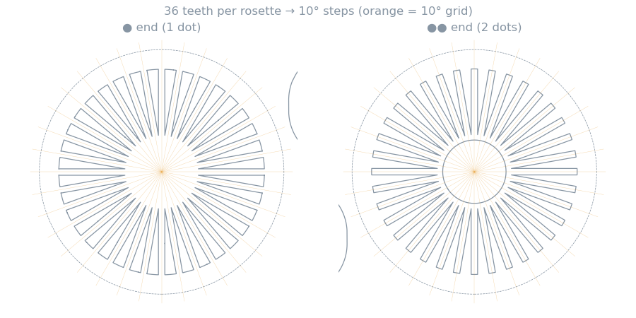
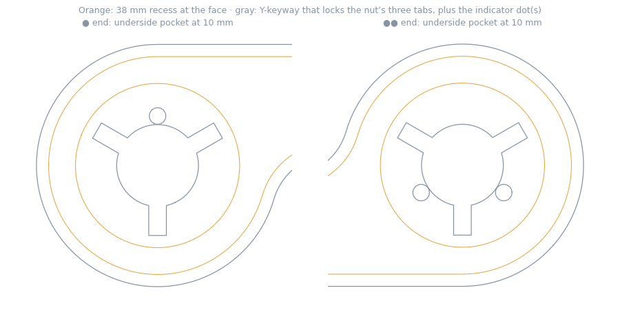
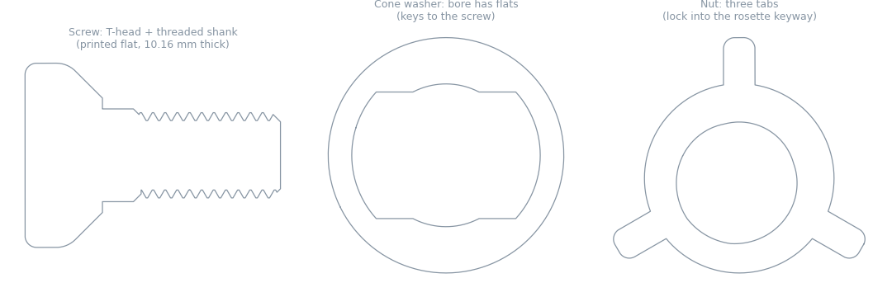
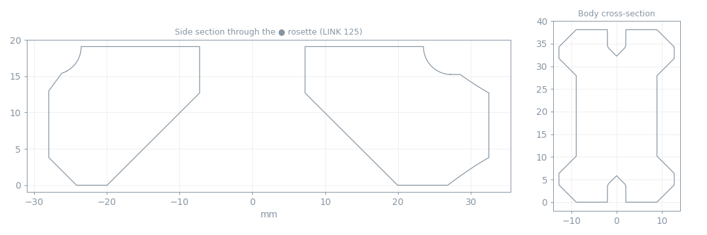

# Engineering Notes

What the STL files themselves reveal about how Link-A-Link is designed. The library ships only meshes (no STEP, no drawings), so everything here was **measured from the STLs**: slicing parts, ray-casting tooth profiles, and computing volumes. It's cross-checked against the Kickstarter campaign where possible.

!!! info "Confidence"
    Measurements are exact to the mesh (±0.05 mm). *Interpretations* of **why** something is shaped a certain way are marked as such.

## Headline findings

| # | Finding | What it means for you |
|---|---|---|
| 1 | Every link rosette has **36 teeth** | Joints index in **10° steps**. Fine angles come from the Swivel, Ball Joint or base rotation |
| 2 | ● and ●● rosettes are **clocked half a tooth apart** and differ in tooth height | This is the real reason for the **1-meets-2 rule** |
| 3 | You tighten a joint by turning the **T-head screw**. The **nut is locked** by three tabs in a Y-shaped keyway | Grip the screw head (or use the tool on it). The nut can't spin |
| 4 | Standard Links are **cranked**: the two rosettes sit 30.5 mm apart sideways | True pivot-to-pivot is a little longer than the name (a 200 link is 202.3 mm) |
| 5 | The CAD was drawn in **inches** | 1.5″ thick links, 2.2″ rosettes, a 1″ rail, a 2″ payload interface. Useful if you remix |
| 6 | The rail is a **1″ inverted-T**, not an industry standard | You can make an aluminium one from two flat bars, or bolt printed rails onto 2020 extrusion |
| 7 | Arms weigh more than you'd think: a 200 mm link is ~110 g in PLA+ | Count the arm in your torque. See the [Load Calculator](../blueprints/load-calculator.md) |

## The rosette (toothed joint)

* **Ø 55.9 mm** (2.20″) face, **36 radial teeth** (10° pitch), about **1.2 mm** tooth height. It's a shallow Hirth-style face coupling.
* **Bore Ø 14.48 mm** for a screw of ~14 mm major diameter, so ~0.24 mm radial clearance.
* Every link-type part uses the identical rosette: Standard Links, Branch Links, Payload Links (fixed and swivel), Modular Link teethed joints and the Microphone Mount base. That's why anything mates with anything.
* The **Microphone Mount's second pivot** is a smaller 36-tooth rosette with a Ø 9.5 mm bore and its own small hardware.

### Why ● must meet ●●

Ray-casting both ends of every link shows **two rosette variants**:

| Variant | Marking | First tooth edge (in the part's own frame) | Tooth crest height |
|---|---|---|---|
| **Type 1** | ● (one dot), files named `- 1`, *1 Circle*, *1 Dots* | 2.5° | lower |
| **Type 2** | ●● (two dots), files named `- 2`, *2 Circles*, *2 Dots* | 7.75° | ~0.7 mm higher |

The two tooth rings are offset by **about half a tooth (~5°)**. When you flip one link onto another, a ●–●● pair lands with its teeth where the designer intended. A ●–● or ●●–●● pair lands half a tooth off: either the teeth ride tip-on-tip and never seat, or every angle you can reach is shifted 5° from the intended set. *Interpretation:* the tooth-height difference looks deliberate too, sizing the engagement for the specific ●/●● pairing.

**Where each variant lives:**

| Part | ● (Type 1) | ●● (Type 2) |
|---|---|---|
| Standard Link | one end | other end |
| Payload Link (fixed, swivel) | `- 1` | `- 2` |
| 3-Way Branch | one end **and** the side stub | other end |
| 4-Way Branch | one end **and** both side stubs | other end |
| Modular Link | `Teethed Joint - 1` | `Teethed Joint - 2` |
| Microphone Mount Base | `1 Dots` | `2 Dots` |

So a Branch Link's side outputs are all ●: whatever you hang off them must present its ●● end.

### The underside: seats and keyways

Each rosette's underside has a **38 mm, 45° conical seat** (orange). Inside it, a **Y-shaped keyway** takes the nut's three tabs. The **indicator dots** are small holes inside the pocket: 1 or 2 of them, visible when you look into the underside.

## The hardware

| Part | What the geometry says |
|---|---|
| **Screw** | Wide **T-head** (a built-in wing grip, 30 mm across). Shank ~14 mm major Ø with a ~2 mm pitch thread. Printed **lying flat**, so the thread is truncated by two flats to a 10.16 mm (0.4″) thickness. Layers run along the screw, which is the campaign's “layer-oriented strength” claim |
| **Cone washer** | Ø 38.1 mm with a 45° cone that matches the rosette seat. Its bore has **two flats**, so it keys to the screw's flats and turns with the screw |
| **Threaded nut** | Cone-backed, with **three radial tabs** that drop into the rosette's Y-keyway, so the nut **cannot rotate**. `- No Brand` only drops the logo on the face |

**So, to tighten a joint:** drop the nut into one rosette's pocket (tabs in the keyway), pass the screw + washer through from the other side, and **turn the T-head**. The tool helps on the T-head for the last bit of torque.

!!! tip "Why the cones matter"
    Both the washer and the nut bear on 45° cones, not flat faces. Clamping force pulls the parts onto the axis, which centres the joint and spreads load around the rosette rather than onto the edge of the bore.

## Links are cranked

* Both rosettes on a Standard Link are on the **same face** (teeth up, 0–20 mm of the 38.1 mm height). The body is a raised **dog-bone / I-section** 25.4 × 38.1 mm (1″ × 1.5″) with shallow V-grooves along the top and bottom.
* The two rosettes are offset **±15.25 mm from the body centreline** (30.5 mm, 1.2″, apart sideways). The number in the name is the distance **along** the link, so the true pivot distance is longer:

| Name | True pivot-to-pivot |
|---|---|
| 125 | 128.7 mm |
| 150 | 153.1 mm |
| 175 | 177.6 mm |
| 200 | 202.3 mm |
| 225 | 227.1 mm |
| 250 | 251.8 mm |
| 275 | 276.7 mm |
| 300 | 301.5 mm |

*Interpretation:* the crank lets the flipped neighbour sit beside the body instead of colliding with it when the joint folds tight.

* **Branch Links** use the same 7″ (177.8 mm) main pitch with the same crank. Side stubs sit **63 mm** from the centreline at 90°.
* The **Base Link Joints** turn the rosette sideways: the first pivot is a horizontal (elevation) hinge. Rotation about vertical comes from the Rotating C-Clamp / Fixed Rotating Base.

## Inch-based design

Most defining dimensions are round inches: link height 38.1 (1.5″), rosette 55.9 (2.2″), body 25.4 (1″), crank 30.5 (1.2″), screw thickness 10.16 (0.4″), nut height 12.7 (0.5″), payload interfaces 50.8 (2″), rail 25.4 × 11.43 (1″ × 0.45″), tensioned clamp bases 66 / 127 / 228.6 (2.6″ / 5″ / 9″). The link *pitches* are metric (125–300 mm). The uppercase `.STL` extension is typical of SolidWorks exports. *Interpretation:* if you remix, work in inches and the numbers come out round.

## The rail profile

<svg class="bp" viewBox="-60 -40 760 330" xmlns="http://www.w3.org/2000/svg" role="img" aria-label="Rail profile"><defs><marker id="ar2" viewBox="0 0 10 10" refX="5" refY="5" markerWidth="6" markerHeight="6" orient="auto-start-reverse"><path d="M 0 0 L 10 5 L 0 10 z" class="arrow"/></marker><pattern id="grid3" width="20" height="20" patternUnits="userSpaceOnUse"><path d="M 20 0 L 0 0 0 20" class="gridln"/></pattern></defs><rect x="-60" y="-40" width="760" height="330" fill="url(#grid3)" class="bpbg"/><!-- surface --><rect x="-30" y="190" width="330" height="18" class="surface"/><text x="135" y="232" class="lbl small" text-anchor="middle">desk / bench / shelf (installed orientation)</text><!-- rail, installed flange-up, scale 10 px/mm; origin at left of flange; stem bottom on surface at y=190 --><!-- flange: 254 wide x 50.8 tall, top at y=190-114.3=75.7 ; stem 152.4 wide x 63.5 tall --><path d="M 0 94.7 L 19 75.7 L 235 75.7 L 254 94.7 L 254 126.5 L 203.2 126.5 L 203.2 190 L 50.8 190 L 50.8 126.5 L 0 126.5 Z" class="lnk-fill" opacity=".85"/><!-- counterbore --><rect x="76" y="75.7" width="101.6" height="50" class="bpbg-fill" opacity=".9"/><rect x="104.5" y="125.7" width="45" height="64.3" class="bpbg-fill" opacity=".9"/><text x="127" y="105" class="lbl small" text-anchor="middle">Ø10.16 c'bore</text><text x="127" y="165" class="lbl small" text-anchor="middle">Ø4.5</text><!-- dims --><line x1="0" y1="45" x2="254" y2="45" class="dim" marker-start="url(#ar2)" marker-end="url(#ar2)"/><text x="127" y="37" class="lbl" text-anchor="middle">25.40 mm (1.000″) flange</text><line x1="50.8" y1="258" x2="203.2" y2="258" class="dim" marker-start="url(#ar2)" marker-end="url(#ar2)"/><text x="127" y="280" class="lbl" text-anchor="middle">15.24 mm (0.600″) stem</text><line x1="275" y1="75.7" x2="275" y2="126.5" class="dim" marker-start="url(#ar2)" marker-end="url(#ar2)"/><text x="283" y="106" class="lbl">5.08 (0.200″)</text><line x1="275" y1="126.5" x2="275" y2="190" class="dim" marker-start="url(#ar2)" marker-end="url(#ar2)"/><text x="283" y="163" class="lbl">6.35 (0.250″) gap</text><line x1="-22" y1="75.7" x2="-22" y2="190" class="dim" marker-start="url(#ar2)" marker-end="url(#ar2)"/><text x="-30" y="140" class="lbl small" text-anchor="end">11.43</text><!-- carriage jaw (right side) --><g transform="translate(430,0)"><text x="130" y="30" class="lbl strong" text-anchor="middle">Carriage slot (Rail Base Link Joint)</text><path d="M 0 60 L 260 60 L 260 176 L 207 176 L 207 125 L 256 125 L 256 72 L 4 72 L 4 125 L 47 125 L 47 176 L 0 176 Z" class="base" opacity=".75"/><text x="130" y="103" class="lbl small" text-anchor="middle">cavity 25.66 × ≈5.3 (flange)</text><line x1="47" y1="200" x2="207" y2="200" class="dim" marker-start="url(#ar2)" marker-end="url(#ar2)"/><text x="127" y="222" class="lbl small" text-anchor="middle">opening 15.50 (stem)</text><text x="23" y="160" class="lbl small" text-anchor="middle">lip</text><text x="233" y="160" class="lbl small" text-anchor="middle">≈5.1</text></g></svg>

* **Rail:** 25.40 × 11.43 mm. A 25.40 × 5.08 mm flange on a 15.24 mm stem, 200 mm long.
* **Screw holes:** Ø 4.5 mm (M4 / #8 clearance) with a Ø 10.16 mm counterbore on the **flange** side, at **80 mm pitch** (20 / 100 / 180 mm).
* **Installed flange-up:** the counterbores face up so the screw heads sit below the flange surface, the stem sits on the surface, and the carriage's lips hook under the flange.
* **Carriage slot:** 15.50 mm opening (0.13 mm clearance per side on the stem), 25.66 mm cavity for the flange.

### Can I buy an aluminium rail instead?

**Not off the shelf.** The profile doesn't match Picatinny/Weaver (21.2 mm dovetail), ARCA-Swiss (38 mm dovetail), woodworking T-track (a *female* slot), or 20-series extrusion (also a female slot). But two routes work:

1. **Build one from two flat bars.** A **1″ × 3/16″** aluminium flat bar as the flange, screwed on top of a **1/2″ × 1/4″** flat bar as the stem, with countersunk screws through both into the surface. 3/16″ (4.76 mm) is a touch thinner than the printed 5.08 mm flange: the locking joint will take up the slack, and the free-sliding joint will be a little looser. Don't use a 5/8″ stem (15.9 mm), which is wider than the 15.5 mm opening.
2. **Stiffen printed rails with 2020 extrusion.** The Ø 4.5 mm holes at 80 mm pitch line up with a 20 mm grid. Bolt printed rails to a 2020 extrusion with **M4 socket-head screws + 20-series M4 drop-in T-nuts**. The 15.24 mm stem sits on the 20 mm face. You get a long, dead-straight, rigid rail (a sim rig, shelf edge or bench back) while keeping the printed profile the carriages expect.

## Mass of printed parts

Estimated from STL volume + surface area (shell = walls × 0.42 mm, core at the infill %, PLA+ 1.24 / PETG 1.27 g/cm³). Real prints vary ±15 %.

| Part | PLA+ · 4 walls · 20 % | PETG · 6 walls · 40 % |
|---|---|---|
| Standard Link 125 | 78 g | 119 g |
| Standard Link 200 | 110 g | 167 g |
| Standard Link 275 | 141 g | 216 g |
| Payload Link 50 | 36 g | 53 g |
| Swivel Payload Link (all parts) | 89 g | 130 g |
| Modular Link ends (2 joints + braces + washers) | 104 g | 145 g |
| Modular Link body 200 | 90 g | 134 g |
| 3-Way Branch Link | 132 g | 202 g |
| 4-Way Branch Link | 164 g | 251 g |
| Link hardware set (screw + washer + nut) | 18 g | 21 g |
| Weighted Base Large (empty) | 596 g | 893 g |
| Round Base 200 | 217 g | 332 g |

**Weighted Base ballast** (cavity estimated from cross-sections): Small ≈ 0.3 L, Medium ≈ 0.75 L, Large ≈ 1.3 L. That's roughly **0.45 / 1.1 / 2.0 kg of dry sand** or **1.4 / 3.4 / 5.9 kg of steel BBs**. The fill hole is on the side wall and appears threaded for the printed Plug.

## Other measurements

| Part | Measurement |
|---|---|
| Wall Mount template | 4 × Ø 4.44 mm holes on a 42.7 mm square (60.4 mm diagonal), plus a Ø 30 mm centre hole. Suits #8 / M4 screws |
| VESA 75 plate | 4 × Ø 6.35 mm holes on 75 × 75 mm (loose for M4, as intended), Ø 29 mm centre recess for the payload screw head |
| Cable clips | A U with ~40 mm inner span that straddles the link's 38.1 mm height. The 15–18 “mm” size is the depth of the U: bigger means more room for cable |
| C-Clamp screws | Fixed and Rotating clamp screws have identical geometry (67.6 × 33 × 10.2 mm), so the **Round Pad fits the Rotating clamp too** (a backer pointed this out in the comments) |
| Tool | 67.6 mm Ø × 12.7 mm disc with shaped ends that engage the hardware |
