# Print Plates

Every plate in every supplied 3MF project, with its preview and contents. Open the 3MF in Bambu Studio or OrcaSlicer and print a plate as-is.

## Desk Fixed C-Clamp Collection (40-80mm)

`1. Base Mounts/Clamp Mounts/Fixed C-Clamp Mount/Desk Fixed C-Clamp Collection (40-80mm).3mf`  
**Profile:** 0.28mm Link-A-Link Settings · 0.28 mm · 3 walls · 20% infill · **Supports:** none

<figure><figcaption>1. C-Clamp Mount - 80mm Opening<small>Fixed C-Clamp Mount - Base 80cm, Fixed C-Clamp Mount - Round Pad, Fixed C-Clamp Mount - Screw 60mm</small></figcaption></figure>
<figure>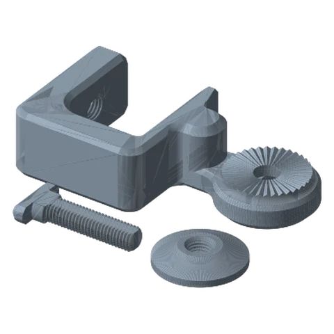<figcaption>2. C-Clamp Mount - 50mm Opening<small>Fixed C-Clamp Mount - Base 50cm, Fixed C-Clamp Mount - Round Pad, Fixed C-Clamp Mount - Screw 60mm</small></figcaption></figure>
<figure><figcaption>3. C-Clamp Mount - 40mm Opening<small>Fixed C-Clamp Mount - Base 40cm, Fixed C-Clamp Mount - Round Pad, Fixed C-Clamp Mount - Screw 60mm</small></figcaption></figure>
<figure>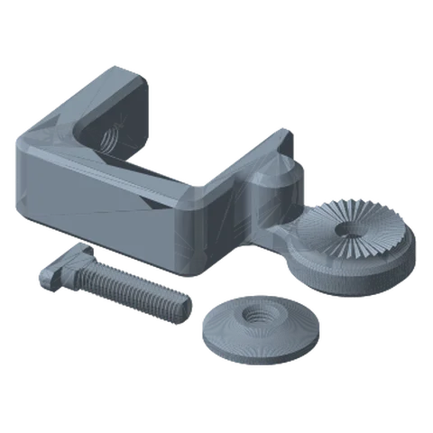<figcaption>4. C-Clamp Mount - 70mm Opening<small>Fixed C-Clamp Mount - Base 70cm, Fixed C-Clamp Mount - Round Pad, Fixed C-Clamp Mount - Screw 60mm</small></figcaption></figure>
<figure>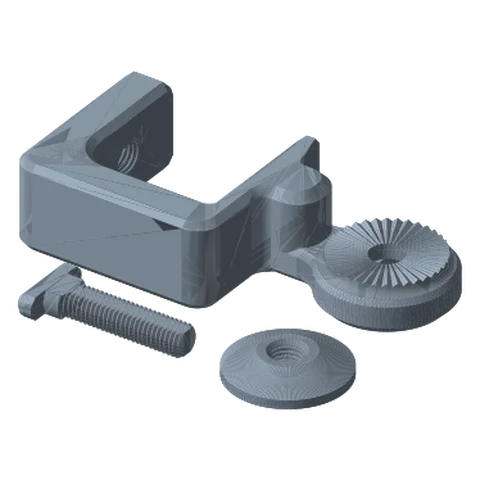<figcaption>5. C-Clamp Mount - 60mm Opening<small>Fixed C-Clamp Mount - Base 60cm, Fixed C-Clamp Mount - Round Pad, Fixed C-Clamp Mount - Screw 60mm</small></figcaption></figure>

## Rotating C-Clamp Collection (40-80mm)

`1. Base Mounts/Clamp Mounts/Rotating C-Clamp Mount/Rotating C-Clamp Collection (40-80mm).3mf`  
**Profile:** 0.28mm Link-A-Link Settings · 0.28 mm · 3 walls · 20% infill · **Supports:** none

<figure><figcaption>1. Rotating C-Clamp - 40mm Opening<small>Rotating C-Clamp Mount - Base 40mm, Rotating Mount - Base Link Joint, Rotating C-Clamp Mount - Screw 60mm, Rotating Mount - Set Screw</small></figcaption></figure>
<figure>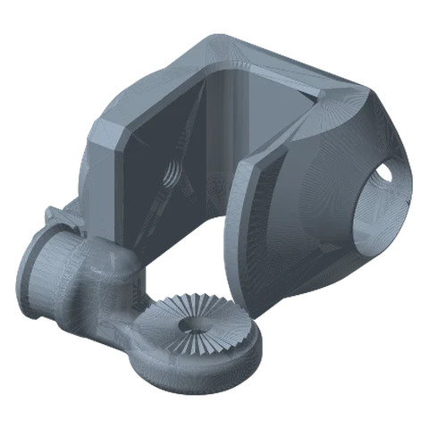<figcaption>2. Rotating C-Clamp - 50mm Opening<small>Rotating C-Clamp Mount - Base 50mm, Rotating Mount - Base Link Joint, Rotating C-Clamp Mount - Screw 60mm, Rotating Mount - Set Screw</small></figcaption></figure>
<figure>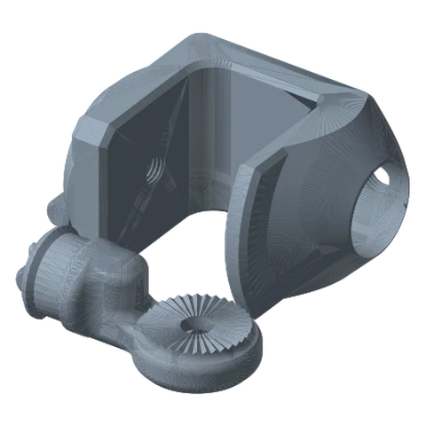<figcaption>3. Rotating C-Clamp - 60mm Opening<small>Rotating C-Clamp Mount - Base 60mm, Rotating Mount - Base Link Joint, Rotating C-Clamp Mount - Screw 60mm, Rotating Mount - Set Screw</small></figcaption></figure>
<figure>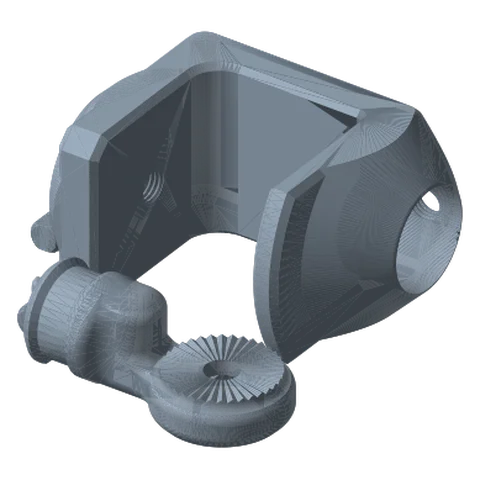<figcaption>4. Rotating C-Clamp - 70mm Opening<small>Rotating C-Clamp Mount - Base 70mm, Rotating Mount - Base Link Joint, Rotating C-Clamp Mount - Screw 60mm, Rotating Mount - Set Screw</small></figcaption></figure>
<figure><figcaption>5. Rotating C-Clamp - 80mm Opening<small>Rotating C-Clamp Mount - Base 80mm, Rotating Mount - Base Link Joint, Rotating C-Clamp Mount - Screw 60mm, Rotating Mount - Set Screw</small></figcaption></figure>

## Base Mount - Desk Base Collection

`1. Base Mounts/Desk Mounts/Base Mount - Desk Base Collection.3mf`  
**Profile:** 0.28mm Link-A-Link Settings · 0.28 mm · 3 walls · 20% infill · **Supports:** none

<figure><figcaption>1. Foot Base - 200mmm<small>Foot Base - 200mm</small></figcaption></figure>
<figure>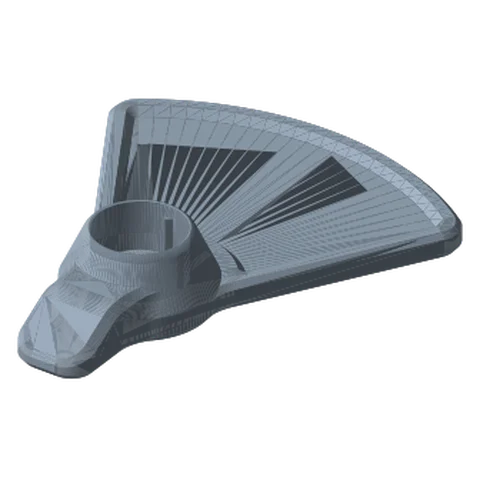<figcaption>2. Foot Base - 220mm<small>Foot Base - 220mm</small></figcaption></figure>
<figure>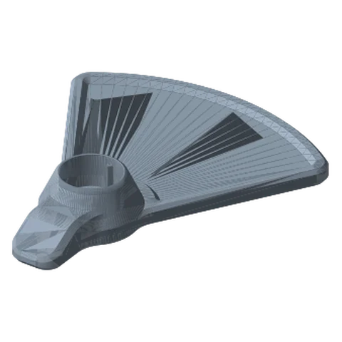<figcaption>3. Foot Base - 240mm<small>Foot Base - 240mm</small></figcaption></figure>
<figure><figcaption>4. Round Base - 180mm<small>Round Base - 180mm</small></figcaption></figure>
<figure>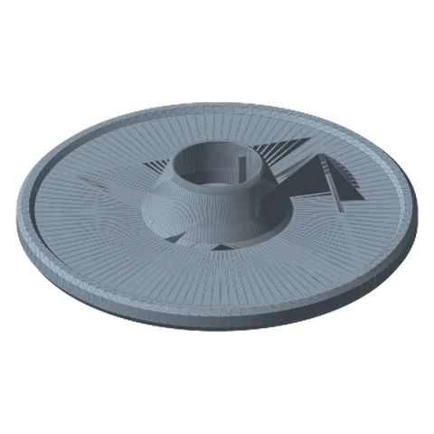<figcaption>5. Round Base - 200mm<small>Round Base - 200mm</small></figcaption></figure>
<figure>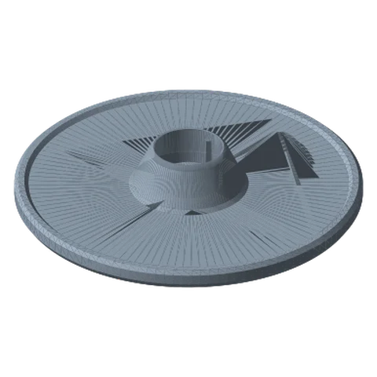<figcaption>6. Round Base - 220mm<small>Round Base - 220mm</small></figcaption></figure>
<figure><figcaption>7. Round Base - 240mm<small>Round Base - 240mm</small></figcaption></figure>
<figure><figcaption>8. Link Joint & Hardware<small>Desk Mount - Base Link Joint, Desk Mount - Washer, Desk Mount - Screw</small></figcaption></figure>

## Fixed Rotating Base

`1. Base Mounts/Desk Mounts/Fixed Rotating Base/Fixed Rotating Base.3mf`  
**Profile:** 0.28mm Extra Draft @BBL X1C · 0.28 mm · 2 walls · 15% infill · **Supports:** none

<figure><figcaption>1. Fixed Rotating Desk Mount<small>Fixed Rotating Base - Base Link Joint, Fixed Rotating Base - Base, Fixed Rotating Base - Set Screw</small></figcaption></figure>
<figure><figcaption>2. Hardware<small>Desk Mount - Washer, Desk Mount - Screw</small></figcaption></figure>

## Rail System

`1. Base Mounts/Rail System Mount/Rail System.3mf`  
**Profile:** 0.28mm Link-A-Link Settings · 0.28 mm · 3 walls · 20% infill · **Supports:** none

<figure><figcaption>1. Rail 200mm<small>3× Rail System - Rail 200mm</small></figcaption></figure>
<figure><figcaption>2. Rail Link Joint<small>Rail System - Base Link Joint</small></figcaption></figure>
<figure><figcaption>3. Rail Locking Link Joint<small>Rail System - Locking Base Link Joint, Rail System - Locking Base Link Joint - Washer, Rail System - Locking Base Link Joint - Screw</small></figcaption></figure>

## Cup Holder Mount

`1. Base Mounts/Vehicle Mounts/Cup Holder Mount/Cup Holder Mount.3mf`  
**Profile:** 0.28mm Link-A-Link Settings · 0.28 mm · 3 walls · 20% infill · **Supports:** none

<figure><figcaption>1. Cup Holder Mount - 80mm<small>Cup Holder Mount - Base 80mm, Cup Holder Mount - Base Link Joint, Cup Holder Mount - Screw, Cup Holder Mount - Washer</small></figcaption></figure>
<figure>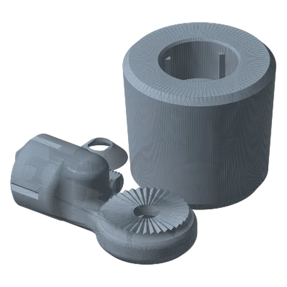<figcaption>2. Cup Holder Mount - 85mm<small>Cup Holder Mount - Base 85mm, Cup Holder Mount - Base Link Joint, Cup Holder Mount - Screw, Cup Holder Mount - Washer</small></figcaption></figure>
<figure>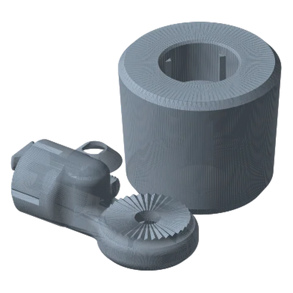<figcaption>3. Cup Holder Mount - 90mm<small>Cup Holder Mount - Base 90mm, Cup Holder Mount - Base Link Joint, Cup Holder Mount - Screw, Cup Holder Mount - Washer</small></figcaption></figure>
<figure><figcaption>4. Cup Holder Mount - 95mm<small>Cup Holder Mount - Base 95mm, Cup Holder Mount - Base Link Joint, Cup Holder Mount - Screw, Cup Holder Mount - Washer</small></figcaption></figure>

## Fixed Wall Mount

`1. Base Mounts/Wall Mounts/Fixed Wall Mount/Fixed Wall Mount.3mf`  
**Profile:** 0.28mm Link-A-Link Settings · 0.28 mm · 3 walls · 20% infill · **Supports:** none

<figure>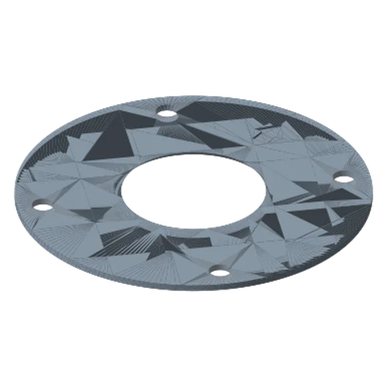<figcaption>1. Wall Mount - Hole Pattern Template<small>Wall Mount - Hole Pattern Template</small></figcaption></figure>
<figure>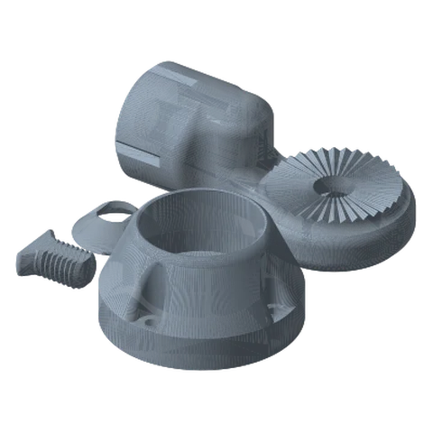<figcaption>2. Wall Mount Assembly<small>Wall Mount - Base Link Joint, Wall Mount - Fixed Base, Wall Mount - Washer, Wall Mount - Screw</small></figcaption></figure>

## Weighted Base

`1. Base Mounts/Weighted Bases/Weighted Base.3mf`  
**Profile:** 0.28mm Link-A-Link Settings · 0.28 mm · 3 walls · 20% infill · **Supports:** none

<figure><figcaption>1. Weighted Base - 125mm<small>Weighted Base - Small - 125mm</small></figcaption></figure>
<figure><figcaption>2. Weighted Base - 175mm<small>Weighted Base - Medium - 175mm</small></figcaption></figure>
<figure><figcaption>3. Weighted Base - 225mm<small>Weighted Base - Large - 225mm</small></figcaption></figure>
<figure><figcaption>4. Weighted Base - Link Joint & Hardware<small>Weighted Base - Base Link Joint, Weighted Base - Screw, Weighted Base - Washer, Weighted Base - Plug</small></figcaption></figure>

## Modular Link

`2. Links/1. Locking Links/1. Modular Link/Modular Link.3mf`  
**Profile:** 0.28mm Link-A-Link Settings · 0.28 mm · 3 walls · 20% infill · **Supports:** none

<figure><figcaption>1. Modular Link - Joint Components<small>Modular Link - Teethed Joint - 2, Modular Link - Teethed Joint - 1, 2× Modular Link - Locking Brace, Modular Link - Screw Washer, Modular Link - Nut Washer</small></figcaption></figure>
<figure><figcaption>2. Modular Link Extensions - 60-140mm<small>Modular Link - Link Body - 140mm, Modular Link - Link Body - 120mm, Modular Link - Link Body - 100mm, Modular Link - Link Body - 80mm, Modular Link - Link Body - 60mm</small></figcaption></figure>
<figure><figcaption>3. Modular Link Extensions - 160-240mm<small>Modular Link - Link Body - 240mm, Modular Link - Link Body - 220mm, Modular Link - Link Body - 200mm, Modular Link - Link Body - 180mm, Modular Link - Link Body - 160mm</small></figcaption></figure>
<figure>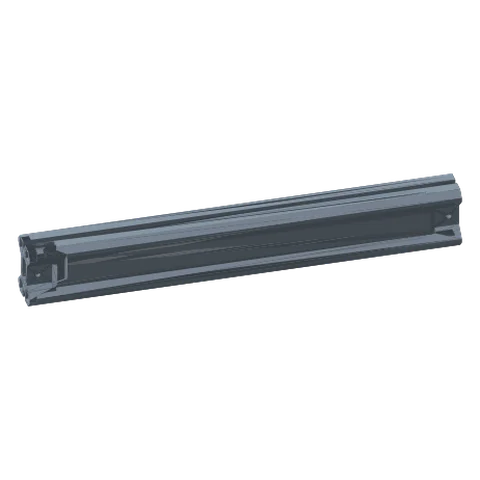<figcaption>4. Modular Link Extension - 260mm<small>Modular Link - Link Body - 260mm</small></figcaption></figure>
<figure>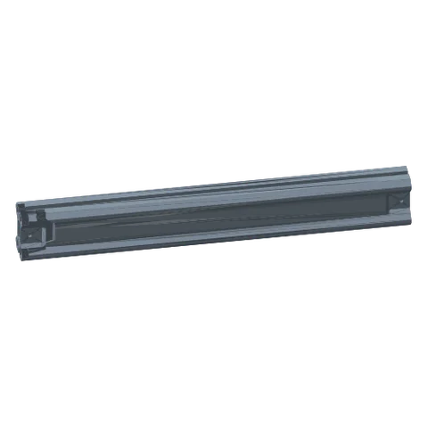<figcaption>5. Modular Link Extension - 280mm<small>Modular Link - Link Body - 280mm</small></figcaption></figure>
<figure>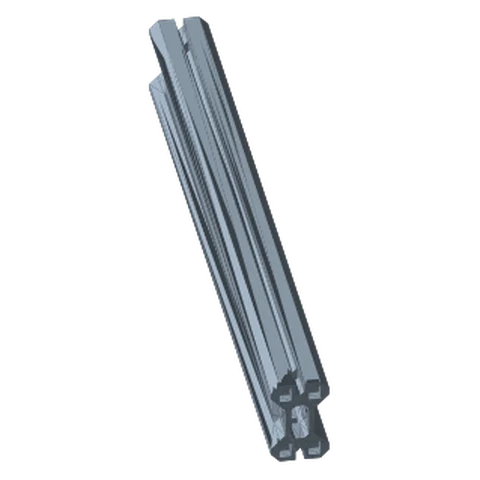<figcaption>6. Modular Link Extension - 300mm<small>Modular Link - Link Body - 300mm</small></figcaption></figure>
<figure><figcaption>7. Modular Link - Hardware<small>2× Link Hardware - Threaded Nut, 2× Link Hardware - Washer, 2× Link Hardware - Screw</small></figcaption></figure>

## Standard Links Collection

`2. Links/1. Locking Links/2. Standard Links/Standard Links Collection.3mf`  
**Profile:** 0.28mm Link-A-Link Settings · 0.28 mm · 3 walls · 20% infill · **Supports:** none

<figure><figcaption>1. Hardware<small>2× Link Hardware - Threaded Nut, 2× Link Hardware - Washer, 2× Link Hardware - Screw</small></figcaption></figure>
<figure><figcaption>2. LINK - 125mm<small>LINK - 125mm</small></figcaption></figure>
<figure>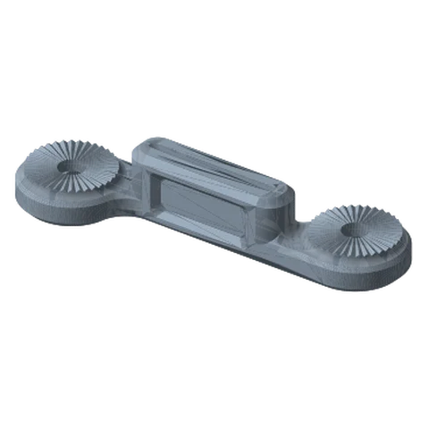<figcaption>3. LINK - 150mm<small>LINK - 150mm</small></figcaption></figure>
<figure>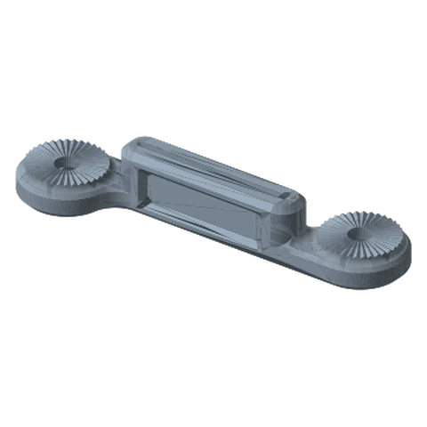<figcaption>4. LINK - 175mm<small>LINK - 175mm</small></figcaption></figure>
<figure><figcaption>5. LINK - 200mm<small>LINK - 200mm</small></figcaption></figure>
<figure>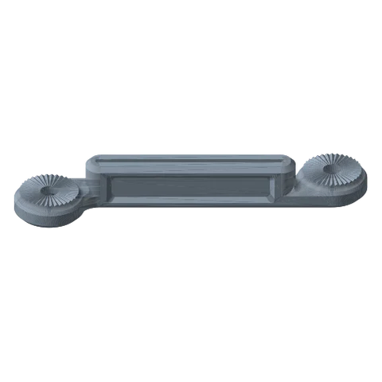<figcaption>6. LINK - 225mm<small>LINK - 225mm</small></figcaption></figure>
<figure>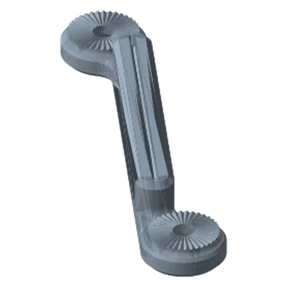<figcaption>7. LINK - 250mm<small>LINK - 250mm</small></figcaption></figure>
<figure><figcaption>8. LINK - 275mm<small>LINK - 275mm</small></figcaption></figure>
<figure><figcaption>9. Payload Link - 1 Circle<small>PAYLOAD LINK - 100mm - 1, PAYLOAD LINK - 75mm - 1, PAYLOAD LINK - 50mm - 1</small></figcaption></figure>
<figure><figcaption>10. Payload Link - 2 Circles<small>PAYLOAD LINK - 100mm - 2, PAYLOAD LINK - 75mm - 2, PAYLOAD LINK - 50mm - 2</small></figcaption></figure>
<figure><figcaption>11. Payload Link - Swivel - 1 Circle<small>Payload Link - Swivel Body - 1, Payload Link - Swivel Insert</small></figcaption></figure>
<figure>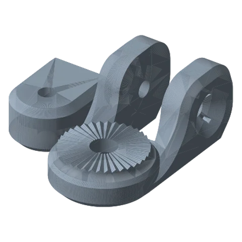<figcaption>12. Payload Link - Swivel - 2 Circles<small>Payload Link - Swivel Body - 2, Payload Link - Swivel Insert</small></figcaption></figure>
<figure><figcaption>13. Payload Link - Swivel - Hardware<small>Payload Link - Swivel - Screw, Payload Link - Swivel - Washer, Payload Link - Swivel - Nut</small></figcaption></figure>
<figure><figcaption>14. 4-Way Branch Link<small>4-Way Branch Link</small></figcaption></figure>
<figure><figcaption>15. 3-Way Branch Link - Top<small>3-Way Branch Link - Top</small></figcaption></figure>
<figure><figcaption>16. 3-Way Branch Link - Bottom<small>3-Way Branch Link - Bottom</small></figcaption></figure>

## Ball Joint Link

`2. Links/1. Locking Links/3. Payload Links/Ball Joint Link/Ball Joint Link.3mf`  
**Profile:** 0.20mm Standard @BBL X1C · 0.2 mm · 2 walls · 15% infill · **Supports:** none

<figure><figcaption>1. Clamps<small>Ball Joint Link - Clamp Bottom, Ball Joint Link - Clamp Top</small></figcaption></figure>
<figure><figcaption>2. Hardware<small>Ball Joint Link - Nut, Ball Joint Link - Set Screw, Ball Joint Link - Washer, Ball Joint Link - Payload Ball Mount P1, Ball Joint Link - Payload Ball Mount P2, Ball Joint Link - Link Ball Mount P2, Ball Joint Link - Link Ball Mount P1, 4× Ball Joint Link - Ball Mount Wedge</small></figcaption></figure>

## CABLE MANAGEMENT CLIPS

`2. Links/1. Locking Links/5. Cable Management/CABLE MANAGEMENT CLIPS.3mf`  
**Profile:** 0.28mm Link-A-Link Settings · 0.28 mm · 3 walls · 20% infill · **Supports:** none

<figure><figcaption>1. Cable Management Clip - 15mm<small>Cable Management Clip - 15mm</small></figcaption></figure>
<figure>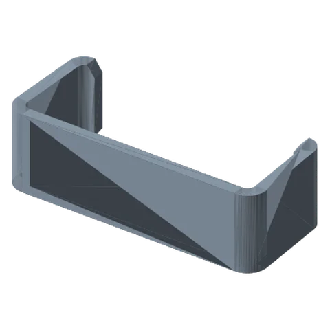<figcaption>2. Cable Management Clip - 16mm<small>Cable Management Clip - 16mm</small></figcaption></figure>
<figure>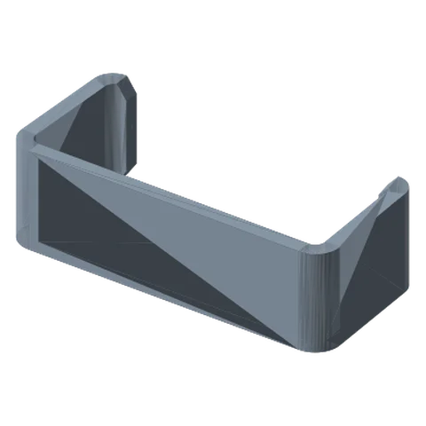<figcaption>3. Cable Management Clip - 17mm<small>Cable Management Clip - 17mm</small></figcaption></figure>
<figure><figcaption>4. Cable Management Clip - 18mm<small>Cable Management Clip - 18mm</small></figcaption></figure>

## 1-4 20 Mount

`3. Payload Mounts/1-4 20 Mount/1-4 20 Mount.3mf`  
**Profile:** 0.28mm Link-A-Link Settings · 0.28 mm · 3 walls · 20% infill · **Supports:** `1-4 20 Mount - Base.STL`

<figure>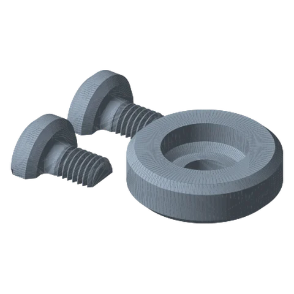<figcaption>1. 1-4 20 Mount<small>1-4 20 Mount - Base, 1-4 20 Mount - Screw Holder P2, 1-4 20 Mount - Screw Holder P1</small></figcaption></figure>

## Baby Pin Mount

`3. Payload Mounts/Baby Pin Mount/Baby Pin Mount.3mf`  
**Profile:** 0.20mm Standard @BBL X1C · 0.2 mm · 2 walls · 15% infill · **Supports:** none

<figure><figcaption>1. Baby Pin Mount - Small<small>Baby Pin Mount - Base, Baby Pin Mount - Screw P2 - Short, Baby Pin Mount - Screw P1 - Short, 2× Baby Pin Mount - Screw Wedge</small></figcaption></figure>
<figure><figcaption>2. Baby Pin Mount - Medium<small>Baby Pin Mount - Screw P2 - Standard, Baby Pin Mount - Screw P1 - Standard, 2× Baby Pin Mount - Screw Wedge, Baby Pin Mount - Base</small></figcaption></figure>
<figure><figcaption>3. Baby Pin Mount - Large<small>Baby Pin Mount - Screw P2 - Long, Baby Pin Mount - Screw P1 - Long, Baby Pin Mount - Base, 2× Baby Pin Mount - Screw Wedge</small></figcaption></figure>

## Laptop Mount

`3. Payload Mounts/Laptop Mount/Laptop Mount.3mf`  
**Profile:** 0.28mm Link-A-Link Settings · 0.28 mm · 3 walls · 20% infill · **Supports:** `Laptop Mount.STL`

<figure>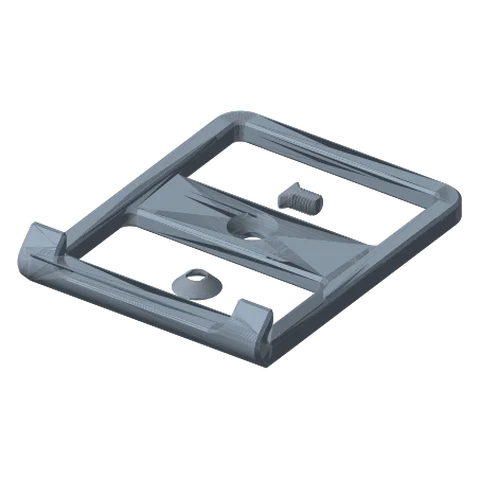<figcaption>1. Laptop Mount<small>Laptop Mount, Laptop Mount - Washer, Laptop Mount - Screw</small></figcaption></figure>

## magSafe Mounts

`3. Payload Mounts/Magsafe Mounts/magSafe Mounts.3mf`  
**Profile:** 0.28mm Link-A-Link Settings · 0.28 mm · 3 walls · 20% infill · **Supports:** `magSafe Mount - New.STL`, `magSafe Mount - Old.STL`

<figure><figcaption>1. Magsafe Mount - New<small>magSafe Mount - New, Magsafe Mount - Washer, Magsafe Mount - Screw</small></figcaption></figure>
<figure><figcaption>2. Magsafe Mount - Old<small>magSafe Mount - Old, Magsafe Mount - Washer, Magsafe Mount - Screw</small></figcaption></figure>

## Microphone Mount

`3. Payload Mounts/Microphone Mount/Microphone Mount.3mf`  
**Profile:** 0.20mm Standard @BBL A1 · 0.2 mm · 2 walls · 15% infill · **Supports:** none

<figure><figcaption>1. Microphone Mount<small>Microphone Mount Screw - Long, Microphone Mount Base - 1 Dots, Microphone Mount Base - 2 Dots, Microphone Mount Screw - Short, Microphone Mount Screw - Standard</small></figcaption></figure>
<figure><figcaption>2. Microphone Mount Hardware<small>Microphone Mount - Link Washer, Microphone Mount - Link Screw, Microphone Mount - Link Nut</small></figcaption></figure>

## Modular T-Claw

`3. Payload Mounts/Modular Tensioned Claw/Modular T-Claw.3mf`  
**Profile:** 0.28mm Link-A-Link Settings · 0.28 mm · 3 walls · 20% infill · **Supports:** `Modular T-Claw - Base.STL`

<figure><figcaption>1. Modular T-Claw<small>Modular T-Claw - Arm Join - Left, Modular T-Claw - Arm Join - Right, Modular T-Claw - Base, Modular T-Claw - Cover</small></figcaption></figure>
<figure><figcaption>2. 60mm Claws<small>Modular T-Claw - Arm 60mm - Right, Modular T-Claw - Arm 60mm - Left</small></figcaption></figure>
<figure>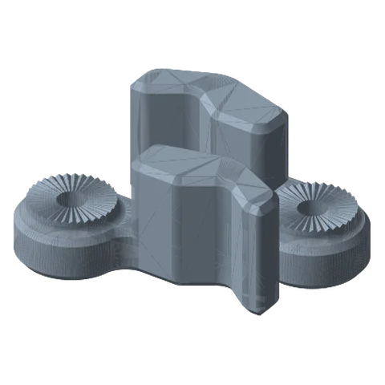<figcaption>3. 70mm Claws<small>Modular T-Claw - Arm 70mm - Left, Modular T-Claw - Arm 70mm - Right</small></figcaption></figure>
<figure><figcaption>4. 80mm Claws<small>Modular T-Claw - Arm 80mm - Left, Modular T-Claw - Arm 80mm - Right</small></figcaption></figure>
<figure><figcaption>5. T-Claw Hardware<small>2× Modular T-Claw - Arm Joint - Screw, 2× Modular T-Claw - Arm Joint - Washer, 2× Modular T-Claw - Arm Joint - Nut</small></figcaption></figure>
<figure>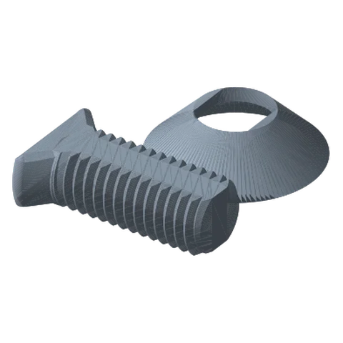<figcaption>6. Payload Connecting Hardware<small>Modular T-Claw - Payload Mount - Washer, Modular T-Claw - Payload Mount - Screw</small></figcaption></figure>

## Phone Mount

`3. Payload Mounts/Phone Mount/Phone Mount.3mf`  
**Profile:** 0.28mm Link-A-Link Settings · 0.28 mm · 3 walls · 20% infill · **Supports:** none

<figure><figcaption>1. Phone Holder - Small<small>Phone Mount - Base - Small, 2× Phone Mount - Arm -Small - Hotshoe, 2× Phone Mount - Arm -Small - Heat Insert, Phone Mount - Cover</small></figcaption></figure>
<figure><figcaption>2. Payload Connecting Hardware<small>Phone Mount - Payload Mount - Washer, Phone Mount - Payload Mount - Screw</small></figcaption></figure>

## Spring Clamp

`3. Payload Mounts/Spring Clamp/Spring Clamp.3mf`  
**Profile:** 0.28mm Link-A-Link Settings · 0.28 mm · 3 walls · 20% infill · **Supports:** all parts

<figure><figcaption>1. Spring Clamp<small>Spring Clamp - Body</small></figcaption></figure>
<figure>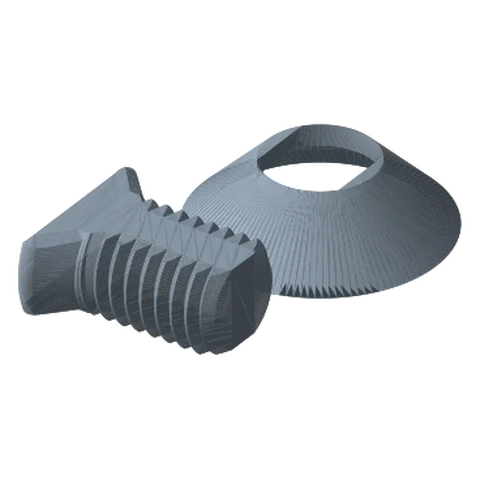<figcaption>2. Hardware<small>Spring Clamp - Washer, Spring Clamp - Screw</small></figcaption></figure>
<figure><figcaption>3. Spring Clamp Inserts - TPU<small>2× Spring Clamp - Insert</small></figcaption></figure>

## L Tensioned Clamp

`3. Payload Mounts/Tensioned Clamps/Large Tensioned Clamp/L Tensioned Clamp.3mf`  
**Profile:** 0.28mm Link-A-Link Settings · 0.28 mm · 3 walls · 20% infill · **Supports:** none

<figure><figcaption>1. L Tensioned Clamp<small>2× L Tensioned Clamp - Arm, L Tensioned Clamp - Base, L Tensioned Clamp - Cover</small></figcaption></figure>
<figure>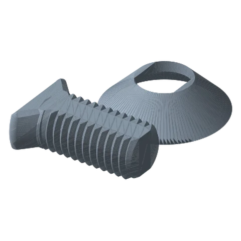<figcaption>2. Hardware<small>L Tensioned Clamp - Washer, L Tensioned Clamp - Screw</small></figcaption></figure>

## M Tensioned Clamp

`3. Payload Mounts/Tensioned Clamps/Medium Tensioned Clamp/M Tensioned Clamp.3mf`  
**Profile:** 0.28mm Link-A-Link Settings · 0.28 mm · 3 walls · 20% infill · **Supports:** `M Tensioned Clamp - Base.STL`

<figure><figcaption>1. M Tensioned Clamp<small>2× M Tensioned Clamp - Arm, M Tensioned Clamp - Base, M Tensioned Clamp - Cover</small></figcaption></figure>
<figure><figcaption>2. Hardware<small>M Tensioned Clamp - Washer, M Tensioned Clamp - Screw</small></figcaption></figure>

## S Tensioned Clamp

`3. Payload Mounts/Tensioned Clamps/Small Tensioned Clamp/S Tensioned Clamp.3mf`  
**Profile:** 0.28mm Link-A-Link Settings · 0.28 mm · 3 walls · 20% infill · **Supports:** `S Tensioned Clamp - Base.STL`

<figure><figcaption>1. S Tensioned Clamp<small>2× S Tensioned Clamp - Arm, S Tensioned Clamp - Base, S Tensioned Clamp - Cover</small></figcaption></figure>
<figure><figcaption>2. Hardware<small>S Tensioned Clamp - Washer, S Tensioned Clamp - Screw</small></figcaption></figure>

## Tensioned Laptop Mount

`3. Payload Mounts/Tensioned Laptop Mount/Tensioned Laptop Mount.3mf`  
**Profile:** 0.28mm Link-A-Link Settings · 0.28 mm · 3 walls · 20% infill · **Supports:** all parts

<figure>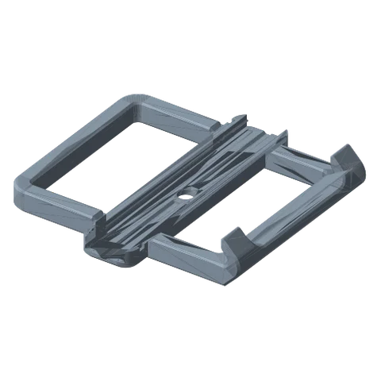<figcaption>1. Tensioned Laptop Holder - Base<small>Tensioned Laptop Mount - Base</small></figcaption></figure>
<figure>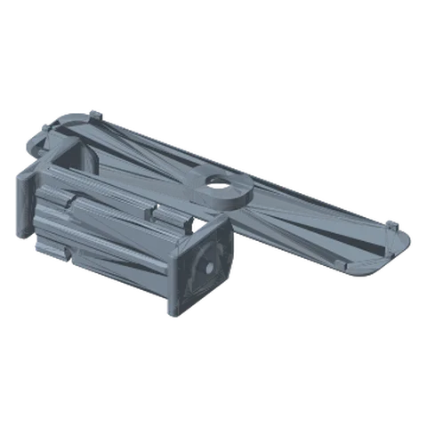<figcaption>2. Tensioned Laptop Holder - Cover & Arms<small>2× Tensioned Laptop Mount - Arm - Heat Insert, Tensioned Laptop Mount - Cover</small></figcaption></figure>
<figure><figcaption>3. Payload Connecting Hardware<small>Payload Mount - Washer, Payload Mount - Screw</small></figcaption></figure>

## Vesa Mounts

`3. Payload Mounts/VESA Mounts/Vesa Mounts.3mf`  
**Profile:** 0.28mm Link-A-Link Settings · 0.28 mm · 3 walls · 20% infill · **Supports:** none

<figure><figcaption>1. VESA Mount - 75mm<small>Vesa Mount - 75mm</small></figcaption></figure>
<figure><figcaption>2. VESA Mount - 100mm<small>Vesa Mount - 100mm</small></figcaption></figure>
<figure><figcaption>3. Payload Connecting Hardware<small>Vesa Mount - Washer, Vesa Mount - Screw</small></figcaption></figure>

